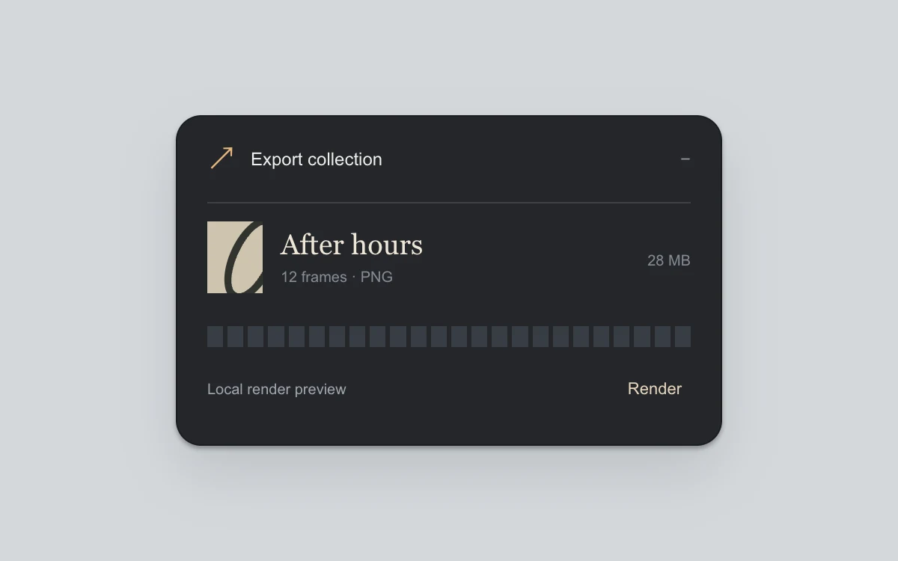

# Activity capsule

> An export collapses into a small persistent capsule without losing its progress.

- **Common name:** Background task progress pill
- **Category:** Components & interactions
- **Live demo:** https://www.subframe.com/motion/activity-capsule
- **Source:** Subframe (original, MIT)
- **Dependencies:** none

## Use case

Keep one background task available while the rest of an interface stays clear.

## Interaction

Render, collapse or expand the task, cancel, and restart.

## Look

Cool grey page with a dark charcoal rounded card: amber arrow glyph, cream serif filename, beige thumbnail and a row of slate progress segments.

## Motion

The header toggle shrinks the card to a 230 px pill with a status label (0.25 s ease-out); 24 segments turn amber as a simulated render advances every 500 ms.

## How to adapt

Collapse is the `.capsule[data-expanded=false]` rule (230 px width, 28 px radius) animated by a 0.25 s transition; details fade in with `activity-w2`. Replace the `setTimeout` progress loop and `phase` states with real task events and the file row with your job.

## Reduced motion

Expansion and progress segments update immediately; the finite task still runs.

## Limitations

A bounded local render simulation, not a real export or downloadable artifact.

## Taxonomy

- **Components:** progress, notification, disclosure
- **Triggers:** press, loading
- **Techniques:** morph, fade
- **Feel:** subtle, refined
- **Contexts:** app
- **Tags:** live-activity, progress, capsule, collapse, background-task, cancel, persistent
- **Also known as:** collapsible progress toast, minimized task indicator, segmented progress bar, background export status
- **Surface color:** `#d5d8dc`

## Code

See [`component.tsx`](component.tsx).
