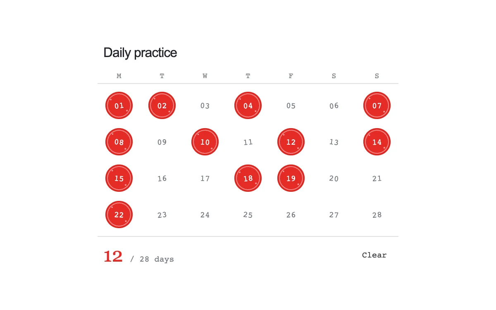

# Activity stamp

> A red ink stamp marks each day in a four-week practice grid and keeps the total in sync.

- **Common name:** Habit tracker grid
- **Category:** Components & interactions
- **Live demo:** https://www.subframe.com/motion/activity-stamp
- **Source:** Subframe (original, MIT)
- **Dependencies:** none

## Use case

Reversible daily completion with compact progress feedback.

## Interaction

Mark days; use arrows to move through the grid.

## Look

White panel with a monospace seven-column four-week grid where completed days are glossy red ink circles, plus a red serif tally and thin grey rules.

## Motion

Marking a day stamps a red circle down from 1.22× scale and 60% opacity to full size over 180 ms ease-out; unmarking and keyboard toggles change instantly.

## How to adapt

The stamp is `@keyframes sf-as-press` (`scale(1.22)` to `scale(1)`, `180ms cubic-bezier(.2,.9,.3,1)`), applied through `data-stamp` to the day just marked in `toggle`. Replace `seed` and the 28-cell range with real dates, and persist `days`.

## Reduced motion

Stamps appear immediately with no scale pulse.

## Limitations

A local 28-day practice grid, not a dated calendar or persisted habit service.

## Taxonomy

- **Components:** toggle, picker
- **Triggers:** press
- **Techniques:** scale, fade
- **Feel:** subtle, playful
- **Contexts:** app
- **Tags:** habit, calendar, stamp, toggle, grid, completion, keyboard
- **Also known as:** streak calendar, daily check-in grid, stamp to complete, attendance tracker
- **Surface color:** `#ffffff`

## Code

See [`component.tsx`](component.tsx).
