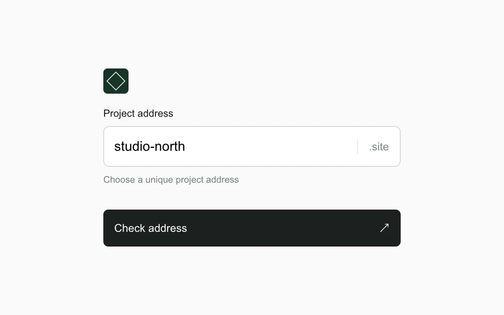

# Address check

> A project-address field moves from checking to an inline validation result.

- **Common name:** Async input validation
- **Category:** Components & interactions
- **Live demo:** https://www.subframe.com/motion/address-check
- **Source:** Subframe (original, MIT)
- **Dependencies:** none

## Use case

Resolve an address choice while preserving the user’s typing flow.

## Interaction

Edit the address, then blur or select Check address.

## Look

Near-white page with a small dark-green square icon, a white rounded text field with a grey suffix, grey helper text and a full-width near-black button.

## Motion

After blur or submit, edits show a checking state that a 450 ms debounce resolves to available, taken or invalid; errors shift the field border to red over 150 ms.

## How to adapt

Validation is the `useEffect` on `value` and `touched`: a 450 ms `setTimeout`, cleared on every edit, sets `status`, which CSS reads through `data-invalid` and `data-state`. Replace the regex and reserved-name list with your availability request, and abort stale requests.

## Reduced motion

State icons and borders change immediately; validation remains functional.

## Limitations

Uses a local list of reserved names and a syntax rule; it does not check a real domain or service.

## Taxonomy

- **Components:** input
- **Triggers:** state, keyboard, loading
- **Techniques:** gradient
- **Feel:** subtle
- **Contexts:** app
- **Tags:** validation, async, debounce, cancellation, inline, form, availability
- **Also known as:** username availability check, inline field validation, debounced validation, subdomain checker
- **Surface color:** `#fafafa`

## Code

See [`component.tsx`](component.tsx).
