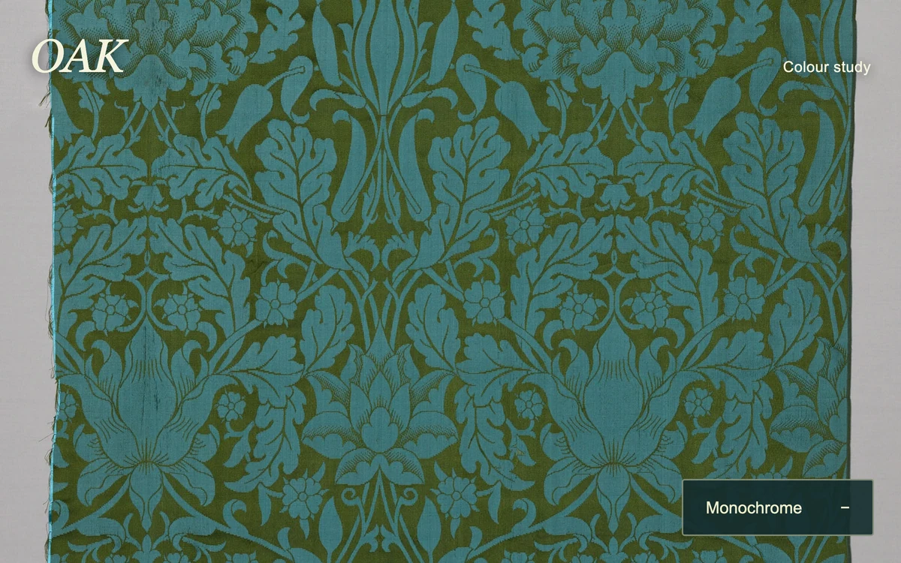

# Afterimage reveal

> A monochrome textile develops its original color under a soft brush, then slowly returns to grey.

- **Common name:** Brush reveal image effect
- **Category:** Animation & motion
- **Live demo:** https://www.subframe.com/motion/afterimage-reveal
- **Source:** Subframe (original, MIT)
- **Dependencies:** none

## Use case

Reveal a second material or image through a persistent, fading pointer trail.

## Interaction

Paint across the textile or develop all its color.

## Look

Full-bleed damask textile of turquoise oak leaves and flowers on olive silk, an italic cream serif title, small caption and a dark teal rectangular button.

## Motion

Moving the pointer stamps soft circles into a mask that reveals colour over the greyscale textile, fading back with a 620 ms time constant; a button shows full colour instantly.

## How to adapt

`stamp` paints radial gradients into the offscreen `mask` (radius `w * 0.105`), `tick` fades it each frame via `destination-out` with time constant `620`, and `draw` composites colour over a `grayscale(1) contrast(1.1)` base. Swap `oak-damask.webp` in `photo.src`; keep the resize handling.

## Reduced motion

The brush is disabled; the Develop color control reveals the complete image instantly.

## Limitations

One same-size image is used for both layers. The fading mask resets when the container resizes.

## Taxonomy

- **Components:** image, cursor
- **Triggers:** pointer, press
- **Techniques:** mask, canvas, fade
- **Feel:** refined, calm
- **Contexts:** editorial, landing
- **Tags:** image reveal, brush, persistent trail, canvas, texture
- **Also known as:** hover color reveal, grayscale to color trail, paint to reveal, fading mask trail
- **Surface color:** `#363e35`

## Assets

- [`oak-damask.webp`](../../assets/oak-damask.webp) — Oak (CC0-1.0)

## Code

See [`component.tsx`](component.tsx).
