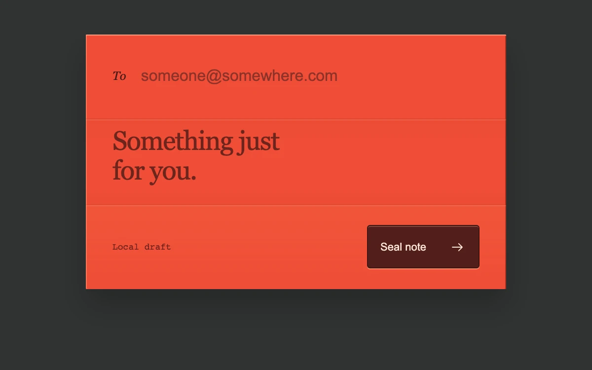

# Folded note

> A private note folds into a sealed paper billet, retaining its contents when opened again.

- **Common name:** Fold-to-send form
- **Category:** Components & interactions
- **Live demo:** https://www.subframe.com/motion/airmail-note
- **Source:** Subframe (original, MIT)
- **Dependencies:** none

## Use case

Give a short local draft a tactile completion state while keeping validation and editing reversible.

## Interaction

Enter a recipient email and note, seal the draft, then open it again; cancel while folding

## Look

Dark charcoal page with a vermilion letter form in three creased panels: italic serif label, large serif note, monospace caption and maroon button.

## Motion

Submitting folds the top panel down, then the bottom panel up (360 ms each, cubic-bezier(.32,.72,0,1)), then the billet tucks to a tilted 0.9 scale; cancel or open restores the form.

## How to adapt

A `phase` state machine (`top`, `bottom`, `tuck`, `sealed`) advances on timers from `LENGTH`; `data-phase` CSS runs `sf-note-top` and `sf-note-bottom` on the `.fold-model` flaps, then `sf-note-tuck` on `.paper`. Wire `onSubmit` to your real send; `remaining` keeps timers pause-safe.

## Reduced motion

Valid submission moves directly to the sealed state without 3D folding or rotation. Reopening retains the same fields and restores text focus.

## Limitations

Local draft only; no message is sent or stored persistently. Host pause and document hiding suspend the finite fold sequence. A production send action requires a real submission handler and successful response before claiming delivery.

## Taxonomy

- **Components:** form, input
- **Triggers:** press, state
- **Techniques:** 3d, rotate, stagger
- **Feel:** playful, refined
- **Contexts:** app, landing
- **Tags:** form, mail, private note, paper, fold, validation, confirmation, choreography
- **Also known as:** paper fold animation, letter folding submit, envelope send animation, origami form submit, contact form success
- **Surface color:** `#303332`

## Code

See [`component.tsx`](component.tsx).
