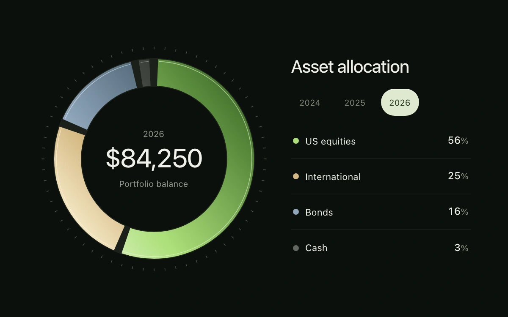

# Allocation ring

> A sculpted portfolio ring redistributes across years while a selected holding keeps its identity.

- **Common name:** Animated donut chart
- **Category:** Components & interactions
- **Live demo:** https://www.subframe.com/motion/allocation-ring
- **Source:** Subframe (original, MIT)
- **Dependencies:** none

## Use case

Inspect how an investment portfolio is divided, then compare the same holding across datasets.

## Interaction

Choose a year; hover, focus or select a holding.

## Look

Near-black dashboard with a gradient donut of green, sand, steel-blue and grey segments inside a circle of ticks, a large balance figure and legend.

## Motion

Changing year slides each arc's dash length and offset to its new share (460 ms ease-out); hovering or selecting a holding thickens its arc and dims the rest.

## How to adapt

Segments are SVG circles with `pathLength` 100 whose `strokeDasharray` and `strokeDashoffset` come from `segments`; the `.arc circle` rule transitions them over 460ms. Replace `HOLDINGS` and `PERIODS` with your data and keep `data-still` for keyboard and pause.

## Reduced motion

Finite transitions become immediate under reduced motion and keyboard input. Host pause disables controls; any owned drag is cancelled.

## Limitations

Fictional portfolio data; no market feed, performance projection or financial calculation beyond sums and shares. Four SVG segments, no chart runtime.

## Taxonomy

- **Components:** chart
- **Triggers:** state, hover, press
- **Techniques:** morph, path, fade
- **Feel:** refined, technical
- **Contexts:** dashboard, app
- **Tags:** portfolio, investment, donut, allocation, data-transition, svg, legend, selection, finance
- **Also known as:** pie chart transition, portfolio breakdown ring, interactive ring chart, asset allocation chart
- **Surface color:** `#0c100c`

## Code

See [`component.tsx`](component.tsx).
