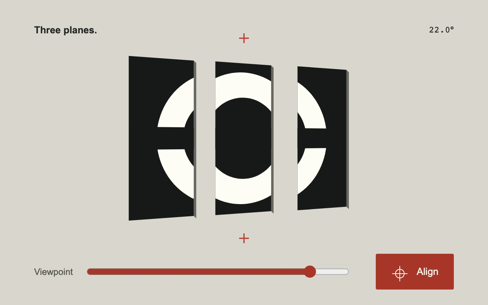

# One exact viewpoint

> White fragments painted across three black depth planes resolve into one divided ring at a precise viewpoint.

- **Common name:** Anamorphic perspective alignment
- **Category:** Animation & motion
- **Live demo:** https://www.subframe.com/motion/anamorphic-registration
- **Source:** Subframe (original, MIT)
- **Dependencies:** none

## Use case

Reveal a geometric identity through spatial alignment, or explain how a viewpoint unifies separated artwork.

## Interaction

Drag the planes or use the Viewpoint range, then press Align to reach the registration point.

## Look

Three matte-black blades carry a sharp white divided ring against warm grey, with red registration crosshairs and a red alignment control.

## Motion

Direct dragging changes the camera yaw and projects each fragment at its own depth. At zero degrees, the silhouettes meet into one mark. Align eases from the current pose; interruption continues from the visible angle.

## How to adapt

`project` inverse-maps the desired registered silhouette onto the depth planes and then applies camera yaw. Replace `OUTLINE`, `COUNTER`, and `CUT` with original paths; adjust `PLANES`, `planeSeparation`, `viewRange`, `snapRadius`, and `snapTime` to change the reveal.

## Reduced motion

Viewpoint changes remain direct; Align and near-target release snap immediately without camera travel.

## Limitations

Three original planar fragments with a horizontal analytic camera orbit. SVG represents perspective geometry; the small edge extrusion is illustrative, with no full 3D lighting, imported model, or free camera.

## Taxonomy

- **Components:** scene, slider, button
- **Triggers:** drag, press, keyboard
- **Techniques:** 3d, path
- **Feel:** refined, technical
- **Contexts:** landing, editorial
- **Tags:** anamorphic, perspective, registration, optical alignment, depth planes, SVG, geometry
- **Also known as:** anamorphic logo reveal, perspective illusion, fragment alignment, viewpoint registration
- **Surface color:** `#d9d7ce`

## Code

See [`component.tsx`](component.tsx).
