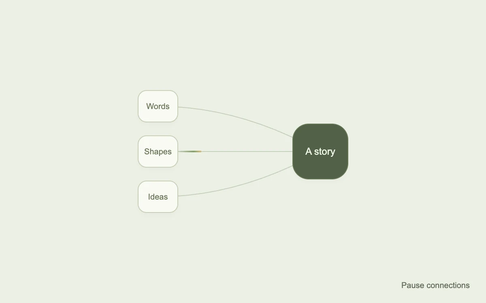

# Threads coming together

> Moving highlights trace three measured paths into a shared destination.

- **Common name:** Animated beam connections
- **Category:** Animation & motion
- **Live demo:** https://www.subframe.com/motion/animated-beam
- **Source:** Magic UI (adapted, MIT) — https://magicui.design/docs/components/animated-beam · [original code](https://github.com/magicuidesign/magicui/blob/85f97fd27b053339af74ba9dd4ca428ee25989fb/apps/www/registry/magicui/animated-beam.tsx)
- **Dependencies:** none

## Use case

Explain aggregation, integrations or a simple flow of information.

## Interaction

Play or pause the connections

## Look

Pale sage page with three small off-white rounded nodes on the left joined by thin grey curves to one larger dark olive rounded tile.

## Motion

A short gold-to-green gradient highlight travels along each curved connector toward the target every 4 s with a strong ease-out spline, the three beams offset by 0.7 s, looping indefinitely.

## How to adapt

`updatePath` measures node centres into quadratic paths (re-run by `ResizeObserver`); each beam is a `linearGradient` whose `x1`/`x2` are driven by SVG `animate` (`dur` 4s, `begin` offset `i * 0.7`). Replace the node labels and the `#d6be80`/`#849f6a` stops.

## Reduced motion

The SVG timeline freezes at a representative point; the full connection diagram remains visible.

## Limitations

Uses native SVG animation and ResizeObserver. This illustrates connections; it does not track actual task completion.

## Taxonomy

- **Components:** chart
- **Triggers:** ambient
- **Techniques:** gradient, path, loop, stagger
- **Feel:** subtle, calm
- **Contexts:** landing
- **Tags:** beam, SVG, flow, connections, diagram, gradient, loop, resize
- **Also known as:** integration diagram animation, connecting lines animation, data flow beams, hub and spoke diagram, SVG connector lines
- **Surface color:** `#edf0e5`

## Code

See [`component.tsx`](component.tsx).
