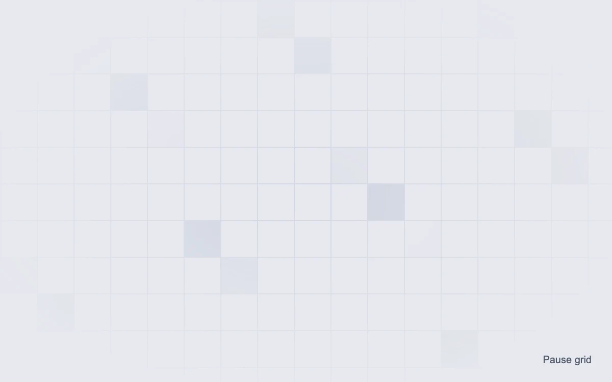

# Pieces taking shape

> Individual cells gently appear and disappear across a fine geometric field.

- **Common name:** Animated grid background
- **Category:** Animation & motion
- **Live demo:** https://www.subframe.com/motion/animated-grid-pattern
- **Source:** Magic UI (adapted, MIT) — https://magicui.design/docs/components/animated-grid-pattern · [original code](https://github.com/magicuidesign/magicui/blob/85f97fd27b053339af74ba9dd4ca428ee25989fb/apps/www/registry/magicui/animated-grid-pattern.tsx)
- **Dependencies:** none

## Use case

Add quiet activity behind a short headline or product illustration.

## Interaction

Play or pause the changing grid

## Look

Pale cool-grey field with a fine light grid of square cells, a few cells tinted soft blue-grey, edges fading out through a radial mask.

## Motion

Eighteen cells fade in and out on staggered 7 s ease-in-out loops, peaking at 0.3 opacity, each relocating to a new grid position after every cycle; a button pauses.

## How to adapt

Cells are 18 `rect` elements from `makeCells` over a `cellSize` (36) SVG `pattern`; each runs `mg-gridpattern-fade` (7 s, peak .3) offset by `--delay`, and `relocate` moves it on `onAnimationIteration`. Tune count, `cellSize`, the keyframe and the `mask-image` falloff.

## Reduced motion

A fixed set of faint cells remains visible with no relocation.

## Limitations

Decorative; does not represent a live heatmap. Cell positions are deterministic and recalculate on container resize.

## Taxonomy

- **Components:** background
- **Triggers:** ambient
- **Techniques:** fade, stagger, loop
- **Feel:** calm, subtle
- **Contexts:** landing
- **Tags:** grid, SVG, cells, opacity, background, loop, ambient, pattern
- **Also known as:** grid background pattern, flickering grid, hero grid background, animated squares backdrop
- **Surface color:** `#e7e9ef`

## Code

See [`component.tsx`](component.tsx).
