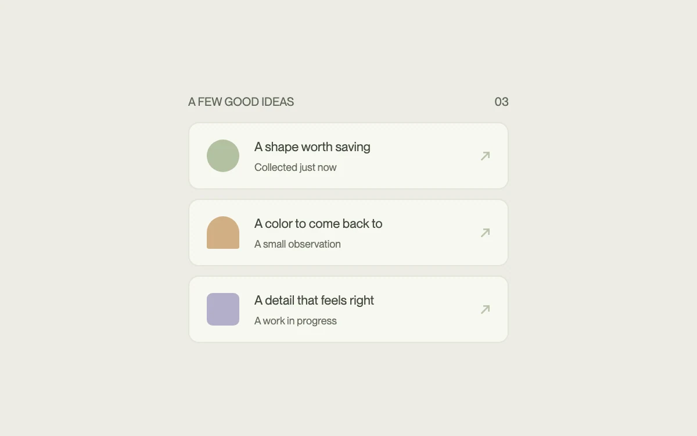

# A few things fall into place

> A small group of related items arrives in a short, measured stagger.

- **Common name:** Staggered list entrance
- **Category:** Animation & motion
- **Live demo:** https://www.subframe.com/motion/animated-group
- **Source:** Motion Primitives (adapted, MIT) — https://motion-primitives.com/docs/animated-group · [original code](https://github.com/ibelick/motion-primitives/blob/120f64f6ca60348e251f929e9c81f11ccbe45eda/components/core/animated-group.tsx)
- **Dependencies:** motion@12.0.5

## Use case

Introduce a compact group of newly loaded or newly created items without delaying interaction.

## Interaction

Replay the group entrance

## Look

Warm off-white page with a small uppercase header over three cream rounded list cards, each holding a muted sage, tan or lilac shape and arrow.

## Motion

On mount the three cards rise 12 px, fade in and unblur from 3 px, staggered 65 ms apart, each over 350 ms with an ease-out-quart curve.

## How to adapt

A `motion.ul` with `staggerChildren` (0.065 s) runs each `motion.li` through `variants` from `hidden` (`opacity` 0, `y` 12, `filter` blur 3 px) to `visible`; tune stagger, `duration` and `ease`. Replace `ideas`; changing the `key` replays it.

## Reduced motion

All items are immediately visible without stagger, travel or blur.

## Limitations

A short three-item entrance. Avoid repeating stagger animations on large lists or frequently used navigation.

## Taxonomy

- **Components:** list, card
- **Triggers:** enter
- **Techniques:** stagger, fade, slide, blur
- **Feel:** subtle, refined
- **Contexts:** app, landing
- **Tags:** list, stagger, group, entrance, reveal, blur, slide, cards
- **Also known as:** staggered fade in, list reveal animation, cards stagger in, sequential entrance, blur slide up stagger
- **Surface color:** `#ecebe5`

## Code

See [`component.tsx`](component.tsx).
