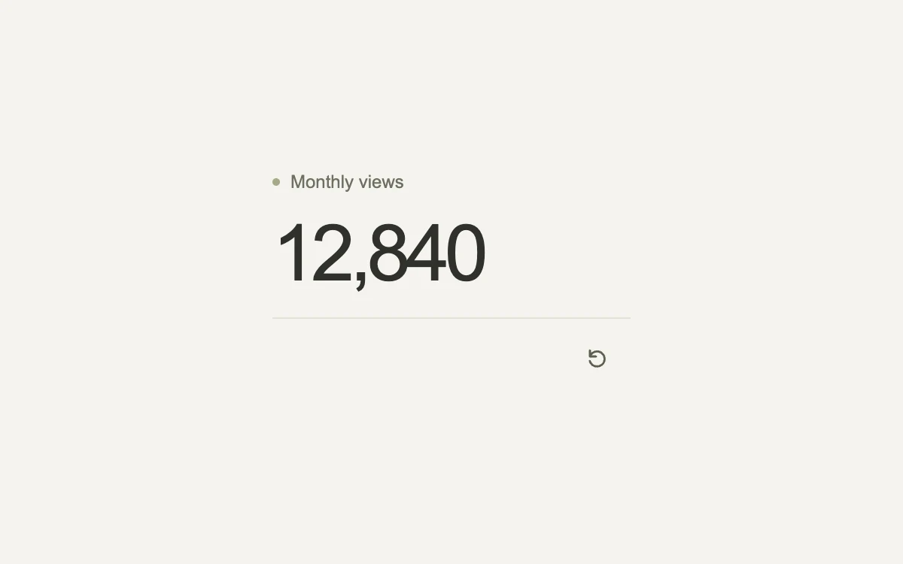

# A number in motion

> A spring-driven value that makes a change in quantity easy to follow.

- **Common name:** Animated number counter
- **Category:** Components & interactions
- **Live demo:** https://www.subframe.com/motion/animated-number
- **Source:** Motion Primitives (adapted, MIT) — https://motion-primitives.com/docs/animated-number · [original code](https://github.com/ibelick/motion-primitives/blob/120f64f6ca60348e251f929e9c81f11ccbe45eda/components/core/animated-number.tsx)
- **Dependencies:** motion@12.0.5

## Use case

Connect two values in a pricing calculator, progress readout or occasional metric update.

## Interaction

Adjust the value

## Look

Warm off-white page with a small olive-dot caption, a large dark tightly tracked tabular numeral, a thin rule and a small refresh icon button.

## Motion

Pressing the refresh button sets a new target and the figure counts to it through a Motion spring (stiffness 180, damping 26, mass 0.7), rounded and comma-formatted each frame.

## How to adapt

The value is `useSpring` (`stiffness: 180, damping: 26, mass: 0.7`) mapped through `useTransform` and `numberFormat` into a `motion.span`; `spring.jump` skips the tween under reduced motion. Replace the `values` array and `setIndex` button with your metric source.

## Reduced motion

The displayed value updates immediately to its target.

## Limitations

Do not announce every animation frame to assistive technology or animate a rapidly updating live feed.

## Taxonomy

- **Components:** number
- **Triggers:** state, press
- **Techniques:** spring
- **Feel:** subtle
- **Contexts:** dashboard, app
- **Tags:** counter, metric, spring, number, data
- **Also known as:** count-up number, number tween, spring counter, KPI value transition
- **Surface color:** `#e9edf0`

## Code

See [`component.tsx`](component.tsx).
