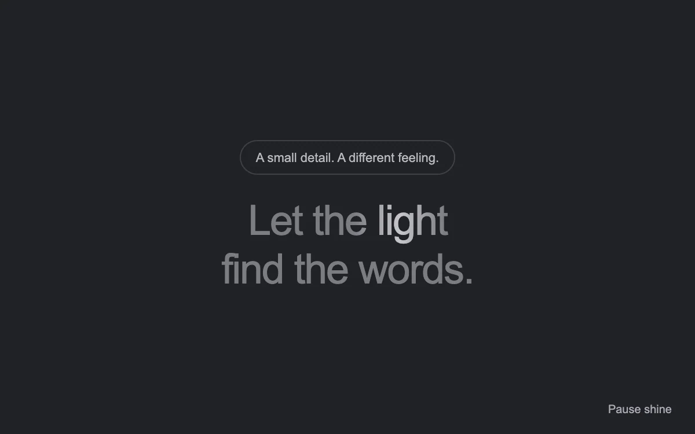

# Light across type

> A narrow highlight passes across the words, then leaves them at rest.

- **Common name:** Shiny text effect
- **Category:** Animation & motion
- **Live demo:** https://www.subframe.com/motion/animated-shiny-text
- **Source:** Magic UI (adapted, MIT) — https://magicui.design/docs/components/animated-shiny-text · [original code](https://github.com/magicuidesign/magicui/blob/85f97fd27b053339af74ba9dd4ca428ee25989fb/apps/www/registry/magicui/animated-shiny-text.tsx)
- **Dependencies:** none

## Use case

Add a restrained sheen to short launch copy or a status label.

## Interaction

Play or pause the text highlight

## Look

Dark charcoal page with a thin-outlined pill caption above a centred two-line grey sans headline, one word catching a white highlight.

## Motion

A narrow white gradient clipped to the text sweeps left to right, rests off-edge, sweeps back and rests again on a 4.5 s ease-in-out loop; a button pauses it.

## How to adapt

The sweep is the `mg-shinytext-pass` keyframes moving a `linear-gradient` on `.mg-shinytext-shine` via `background-clip:text`; tune `background-size` (highlight width), the 4.5s duration and keyframe percentages for rest time. Replace the headline and pill copy.

## Reduced motion

The complete text remains visible with a solid color.

## Limitations

Clipped background gradients repaint. Keep text short and check contrast if adjusting the base color.

## Taxonomy

- **Components:** text
- **Triggers:** ambient
- **Techniques:** glow, gradient, loop
- **Feel:** subtle, refined
- **Contexts:** landing, app
- **Tags:** text, shine, gradient, background clip, headline, idle loop
- **Also known as:** text shimmer, shimmering headline, gradient sweep text, text shine animation, glint across text
- **Surface color:** `#202126`

## Code

See [`component.tsx`](component.tsx).
