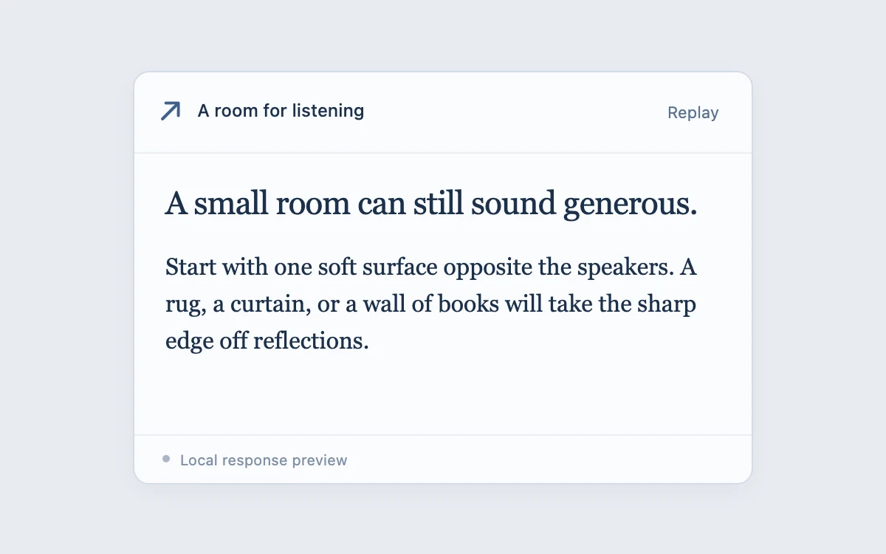

# Answer stream

> A streaming response follows incoming text while preserving the reader’s position when they scroll away.

- **Common name:** Streaming chat autoscroll
- **Category:** Components & interactions
- **Live demo:** https://www.subframe.com/motion/answer-stream
- **Source:** Subframe (original, MIT)
- **Dependencies:** none

## Use case

Keep incoming responses visible without stealing reading position.

## Interaction

Replay or stop the response; scroll up, then jump to the latest text.

## Look

Cool blue-grey page with a white rounded chat pane: arrow-mark header, large navy serif heading and body paragraphs, and a small status footer.

## Motion

Replay streams three characters every 35 ms while the pane pins to the bottom; scrolling up stops following and shows a pill that smooth-scrolls back to the latest text.

## How to adapt

Streaming is a `setInterval` adding 3 to `count` every 35 ms; a `useLayoutEffect` pins `scrollTop` while `follow` is true, and `onScroll` clears it beyond 28 px from the bottom. Replace `BLOCKS` and the timer with your token stream.

## Reduced motion

Jump to latest is immediate; streamed text arrives without decorative motion.

## Limitations

A scripted local response. No model, network request or markdown parser.

## Taxonomy

- **Components:** text
- **Triggers:** loading, scroll, press
- **Techniques:** split-text
- **Feel:** subtle
- **Contexts:** app
- **Tags:** stream, chat, autoscroll, conversation, reading-position, response
- **Also known as:** AI response streaming, stick-to-bottom scroll, typewriter chat reply, scroll to latest button, LLM output follow
- **Surface color:** `#e8ebf0`

## Code

See [`component.tsx`](component.tsx).
