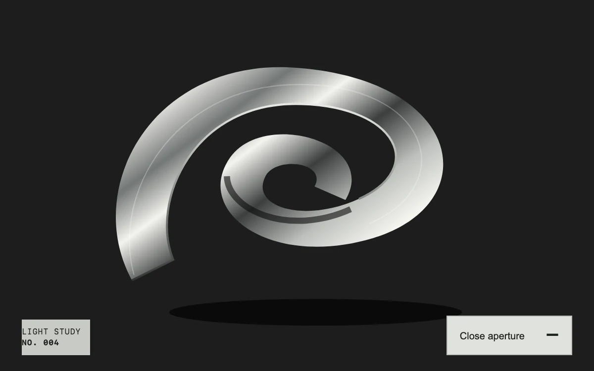

# Light matter

> A circular crop opens into a silver still life, trading graphic tension for the full image.

- **Common name:** Circular image reveal
- **Category:** Animation & motion
- **Live demo:** https://www.subframe.com/motion/aperture-reveal
- **Source:** Subframe (original, MIT)
- **Dependencies:** none

## Use case

Let an art, photography or product story move from an intriguing detail to a full composition without changing context.

## Interaction

Open the aperture

## Look

Brushed-silver spiral ribbon on near-black with a monospace caption and flat grey button; closed, only a central circle shows over pale grey display type.

## Motion

Pressing the button expands a circular clip-path from 25% to 80% over 850 ms with a strong ease-out, revealing the whole image; closing shrinks it back in 560 ms, interruptibly.

## How to adapt

`reveal` animates `clipPath` with `element.animate` from the computed value to `circle(80% at 50% 46%)` or `circle(25% at 50% 46%)`; tune `duration` and the `cubic-bezier(.22,1,.36,1)` easing. Replace the SVG artwork in `.sf-aperture-art` and the ghost headline.

## Reduced motion

The crop changes immediately; keyboard activation also skips the aperture animation.

## Limitations

Uses original vector artwork, not a photograph. Clip-path animation can require painting; keep the artwork bounded and profile larger adaptations.

## Taxonomy

- **Components:** image
- **Triggers:** press
- **Techniques:** mask
- **Feel:** refined, bold
- **Contexts:** editorial, landing
- **Tags:** aperture, iris, reveal, photography, metal, silver, mask, clip path, WAAPI, art direction
- **Also known as:** iris reveal, circle clip-path reveal, circular mask transition, image expand reveal
- **Surface color:** `#c8cac5`

## Code

See [`component.tsx`](component.tsx).
