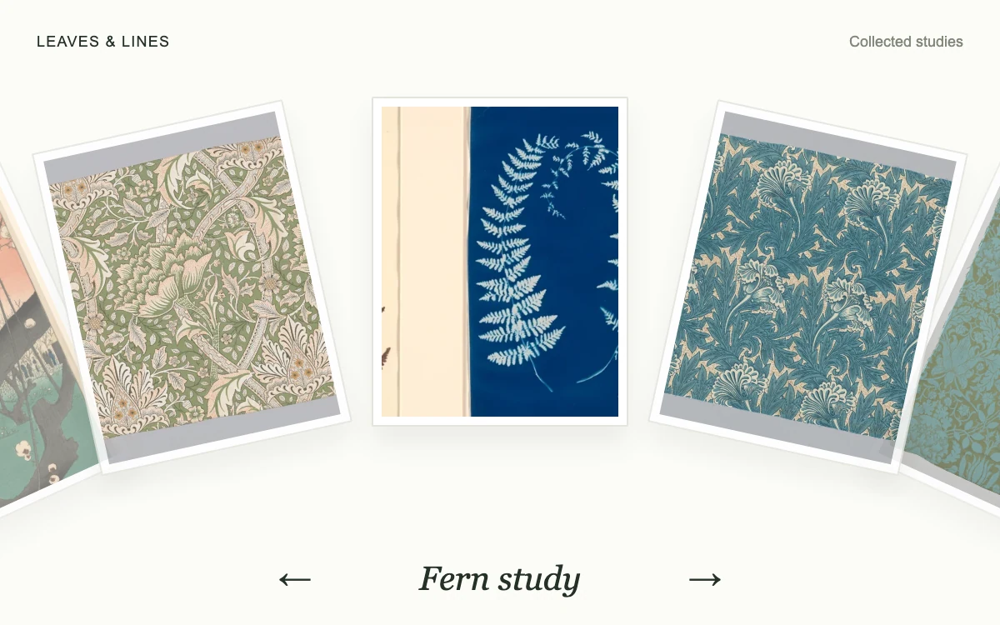

# Arc gallery

> Botanical plates travel around a circular rail, with a single specimen held upright at its apex.

- **Common name:** Circular image carousel
- **Category:** Animation & motion
- **Live demo:** https://www.subframe.com/motion/arc-gallery
- **Source:** Subframe (original, MIT)
- **Dependencies:** none

## Use case

Browse a small collection with a continuous draggable arc and a legible selected item.

## Interaction

Drag the plates or use the previous and next controls.

## Look

Off-white page with five white-matted botanical prints fanned along a downward-curving arc, a small letterspaced header and an italic serif caption between arrows.

## Motion

Dragging or arrow buttons rotate the cards around a circular rail, tilting and fading them with distance; release snaps to the nearest card, nudged by flick velocity, on a spring.

## How to adapt

Card placement is computed in `paint` (arc spacing `0.49` rad per card, tilt `angle * 25`) and the spring in `tick` (stiffness `155`, damping `21`); `choose` sets the target index. Replace the `cards` image and title pairs.

## Reduced motion

Navigation changes the selected plate immediately, without spring interpolation.

## Limitations

Five repeated plates wrap around one circular rail; this is not a free-position canvas.

## Taxonomy

- **Components:** gallery
- **Triggers:** drag, press
- **Techniques:** spring, rotate, fade
- **Feel:** refined
- **Contexts:** editorial, landing
- **Tags:** gallery, arc, drag, spring, botanical
- **Also known as:** arc carousel, curved card slider, rotating image wheel, fanned card carousel, draggable photo carousel
- **Surface color:** `#f2efe7`

## Assets

- [`fern-diptych.webp`](../../assets/fern-diptych.webp) — Untitled (Fern Study), c. 1850, from the Hatton Fern Album (CC0-1.0)
- [`oak-damask.webp`](../../assets/oak-damask.webp) — Oak (CC0-1.0)
- [`plum-garden.webp`](../../assets/plum-garden.webp) — Plum Garden at Kameido (Kameido Umeyashiki), from the series "One Hundred Famous Views of Edo (Meisho Edo hyakkei)" (CC0-1.0)
- [`tulip-print.webp`](../../assets/tulip-print.webp) — Tulip (CC0-1.0)
- [`windrush-print.webp`](../../assets/windrush-print.webp) — Windrush (CC0-1.0)

## Code

See [`component.tsx`](component.tsx).
