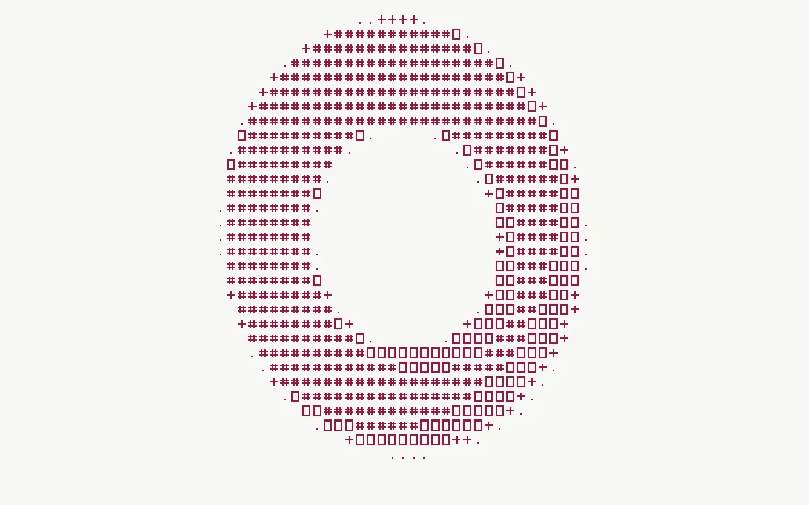

# ASCII relief

> A folded ring is rebuilt from a few precisely drawn glyphs instead of pixels.

- **Common name:** ASCII art shader
- **Category:** WebGL & shaders
- **Live demo:** https://www.subframe.com/motion/ascii-relief
- **Source:** Subframe (original, MIT)
- **Dependencies:** none

## Use case

Turn tonal imagery into a scalable typographic treatment with controllable glyph density.

## Interaction

Adjust character size.

## Look

Burgundy ASCII glyphs (dots, plus signs, hash bars and boxes) forming a shaded oval ring on warm off-white paper, set in a fixed character grid.

## Motion

The ring slowly rocks back and forth (about ±9° on a 31 s sine) and its shading re-quantises into glyphs every frame; a character-size slider changes cell size.

## How to adapt

In `FRAGMENT`, `scene` returns the lit ring's brightness and `glyph` maps it to four 5×7 glyphs by threshold; cell size is `mix(5.,15.,u_control)`. Replace `scene` with your own luminance source, retune the `value` thresholds, and recolour `paper` and `ink`.

## Reduced motion

The elapsed-time clock stops. Parameter controls immediately update the static composition.

## Limitations

Requires WebGL 1; a static CSS swatch appears if unavailable or after context loss. A procedural four-glyph set rendered in GLSL; no font dependency, imported image, or DOM text conversion.

## Taxonomy

- **Components:** background, text
- **Triggers:** ambient
- **Techniques:** shader, rotate
- **Feel:** technical, calm
- **Contexts:** landing, editorial
- **Tags:** native webgl, ascii, glyphs, luminance, text raster, typography
- **Also known as:** ASCII render, text mode graphics, glyph halftone, character grid shader
- **Surface color:** `#f7f7f4`

## Code

See [`component.tsx`](component.tsx).
