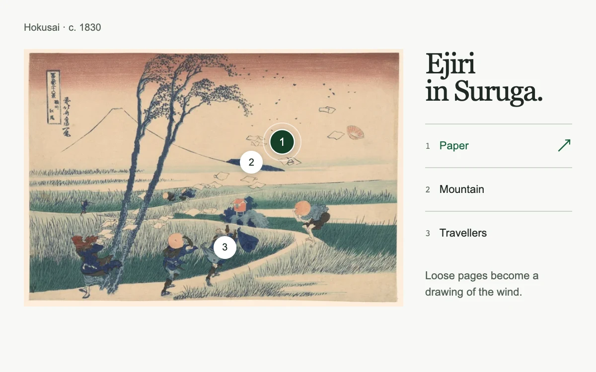

# Inside the image

> Image markers and a compact index share one selection, revealing details without losing the whole picture.

- **Common name:** Image hotspots
- **Category:** Components & interactions
- **Live demo:** https://www.subframe.com/motion/atlas-hotspots
- **Source:** Subframe (original, MIT)
- **Dependencies:** none

## Use case

Explain an artwork, product detail or architectural feature through precisely placed points and a linked list.

## Interaction

Choose a point on the print or a detail in the index

## Look

Off-white page with a Japanese woodblock landscape print marked by numbered white circular pins, beside a large dark serif title and ruled numbered list.

## Motion

Choosing a pin or list item glides a white ring to that point in 250 ms ease-out; the chosen pin darkens and scales to 112% in 180 ms.

## How to adapt

`selected` drives both the `pin` buttons and the `crosshair`. A full-size positioning layer translates to the selected percentage coordinates over 250 ms, carrying a fixed-size ring without animating layout. Replace `details` (names, percentage `x` and `y` coordinates, text) together with the image, since coordinates assume the uncropped artwork.

## Reduced motion

Selection changes immediately; the connecting ring does not travel between points.

## Limitations

Hotspot coordinates assume the supplied uncropped image. Replace coordinates when replacing the image. Host pause disables selection.

## Taxonomy

- **Components:** tooltip, image
- **Triggers:** press, keyboard
- **Techniques:** slide, scale
- **Feel:** subtle, refined
- **Contexts:** editorial, landing
- **Tags:** hotspots, image, annotation, synchronized, selection, art, product, linked list
- **Also known as:** image annotations, interactive image points, product hotspots, clickable image markers, linked image callouts
- **Surface color:** `#f7f8f5`

## Assets

- [`suruga-wind.webp`](../../assets/suruga-wind.webp) — Ejiri in Suruga Province, Hokusai (CC0-1.0)

## Code

See [`component.tsx`](component.tsx).
