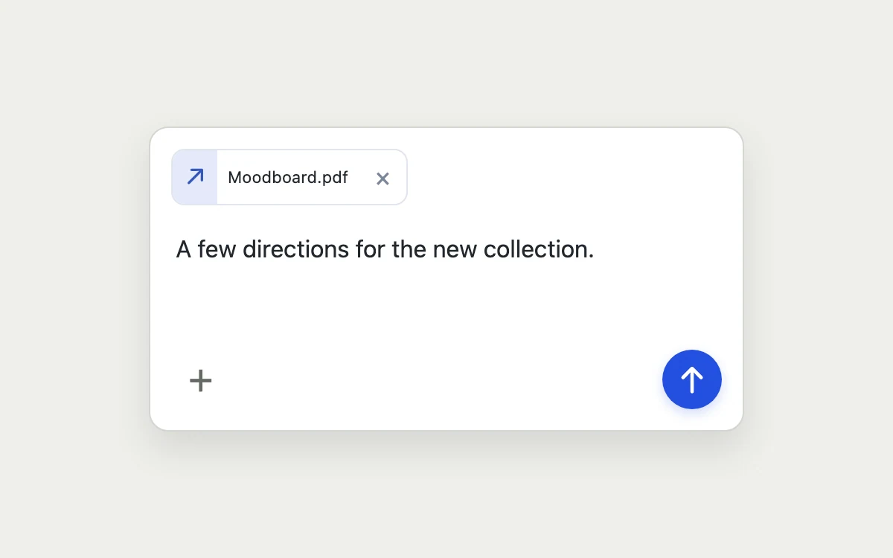

# Attachment composer

> Let attachments enter and leave a message without displacing the writing task.

- **Common name:** Chat composer attachments
- **Category:** Components & interactions
- **Live demo:** https://www.subframe.com/motion/attachment-composer
- **Source:** Subframe (original, MIT)
- **Dependencies:** none

## Use case

Let attachments enter and leave a message without displacing the writing task.

## Interaction

Attach a file and send a note

## Look

White rounded composer card on light warm grey with a bordered file chip, system-font message text, a plus icon and a round blue send button.

## Motion

Attaching a file through the plus button makes its chip rise 5 px and fade in over 200 ms (ease-out); removal and send happen instantly.

## How to adapt

The chip entrance is the `sf-attachment-composer-attachmentIn` keyframe on `.file` (200 ms); tune its offset and duration there. Replace the `files` and `text` seed state and the `onSubmit` handler, which only sets `sent`, with your upload and send logic.

## Reduced motion

Live system preference disables decorative motion; all controls remain usable. Keyboard actions settle immediately.

## Limitations

Files remain local names only. The submit action prepares a local state and sends nothing.

## Taxonomy

- **Components:** input, picker
- **Triggers:** enter, press
- **Techniques:** fade, slide
- **Feel:** subtle
- **Contexts:** app
- **Tags:** composer, attachment, message, upload
- **Also known as:** message input with attachments, file chip upload, chat input box, AI prompt composer, attachment chips
- **Surface color:** `#edf0f3`

## Code

See [`component.tsx`](component.tsx).
