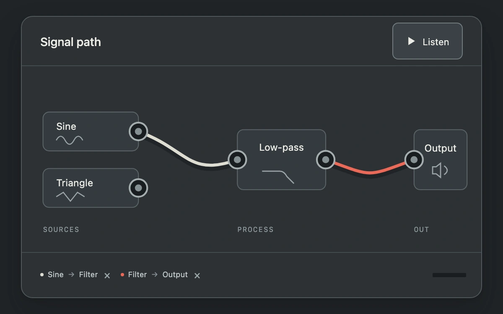

# Patch the signal

> Connect two generated sources through a filter or directly to an output, then audition the resulting route.

- **Common name:** Interactive audio patchbay
- **Category:** Components & interactions
- **Live demo:** https://www.subframe.com/motion/audio-patchbay
- **Source:** Subframe (original, MIT)
- **Dependencies:** none

## Use case

Make audio routing topology editable and show which connections actually reach the output.

## Interaction

Drag an output socket to an input, or select both with keyboard or touch. Listen opts into audio; connection chips remove cables.

## Look

Graphite studio panel with steel socket rings, ivory and red cables, restrained module labels and a small measured output level.

## Motion

A tentative cable follows the pointer; a valid drop creates a curved route with a 160 ms fade. The output level follows real generated audio only after Listen.

## How to adapt

`connect` enforces the bounded routing rules and `cables` is the topology. `listen` creates native audio nodes; `stop` disposes them. `DEFAULT_CONFIG` and the `config` prop expose source spacing, audition pitch, incompatible ports and cable timing.

## Reduced motion

New-cable fades are removed for keyboard input and reduced motion. Audio remains explicit opt-in; host pause, tab hiding and unmount stop and close the owned audio context.

## Limitations

Two quiet generated oscillators, one fixed low-pass filter, one output and at most three cables. No microphone, samples, node creation or arbitrary graphs. The output meter reads an AnalyserNode; audio quality is not a physical-device certification.

## Taxonomy

- **Components:** media, editor, button
- **Triggers:** press, drag, keyboard, state
- **Techniques:** path, fade
- **Feel:** technical, refined
- **Contexts:** app, dashboard
- **Tags:** audio, routing, patchbay, ports, cable, signal, web-audio, connection
- **Also known as:** modular audio routing, patch cable editor, connect audio nodes, signal chain editor
- **Surface color:** `#202427`

## Code

See [`component.tsx`](component.tsx).
