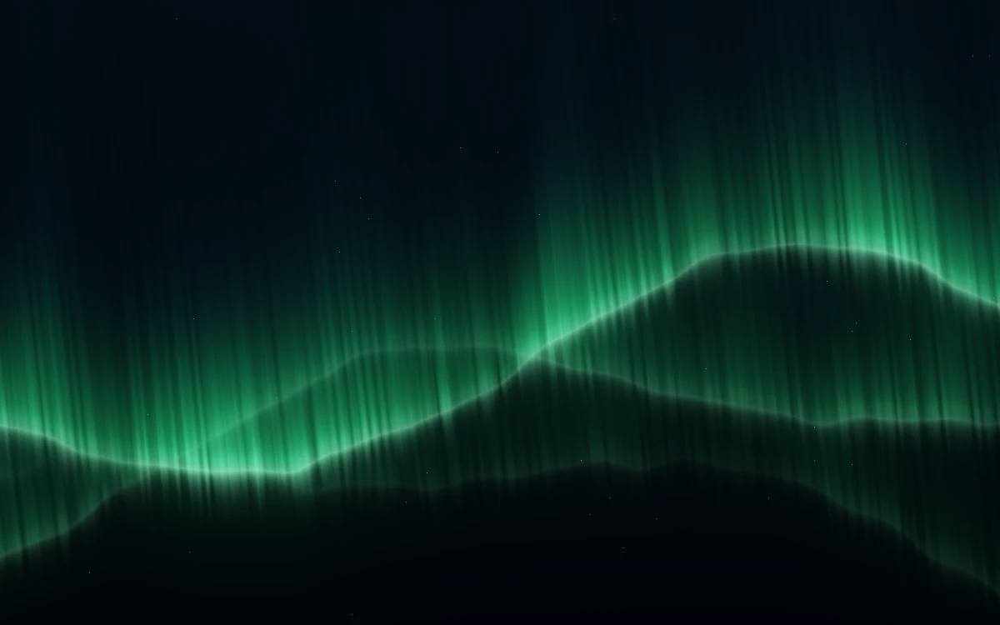

# Aurora curtain

> Soft green filaments rise from a luminous, slowly folding hem as activity changes the curtain’s shape.

- **Common name:** Aurora background shader
- **Category:** WebGL & shaders
- **Live demo:** https://www.subframe.com/motion/aurora-curtain
- **Source:** Subframe (original, MIT)
- **Dependencies:** none

## Use case

Shape a nocturnal atmospheric backdrop without changing its framing.

## Interaction

Adjust activity; pause or resume the curtain

## Look

Deep blue-black night sky with faint stars and layered glowing green curtains of fine vertical filaments rising from wavy luminous hems.

## Motion

Three noise-driven curtain layers slowly bend and fold while their filaments shimmer; the activity slider speeds the drift, deepens folds, and lengthens and brightens the rays.

## How to adapt

The curtain is the `FRAGMENT` shader: three `layer` passes build `hem`, `veil` and `lip` from `noise`, and `u_control` scales speed, folds, height and brightness. Retint via `tint`; keep `sg-aurora-curtain-fallback`, context-loss and reduced-motion handling.

## Reduced motion

Ambient motion stops; activity still redraws the curtain geometry and light immediately.

## Limitations

Original stylized emission field, not a physical aurora simulation. Native WebGL1 with static fallback; remount after context loss.

## Taxonomy

- **Components:** background
- **Triggers:** ambient, state
- **Techniques:** shader, noise, glow
- **Feel:** calm, refined
- **Contexts:** landing, editorial
- **Tags:** aurora, northern lights, curtain, filaments, night, activity, native webgl
- **Also known as:** northern lights background, aurora borealis effect, night sky glow, animated light curtain
- **Surface color:** `#071b1c`

## Code

See [`component.tsx`](component.tsx).
