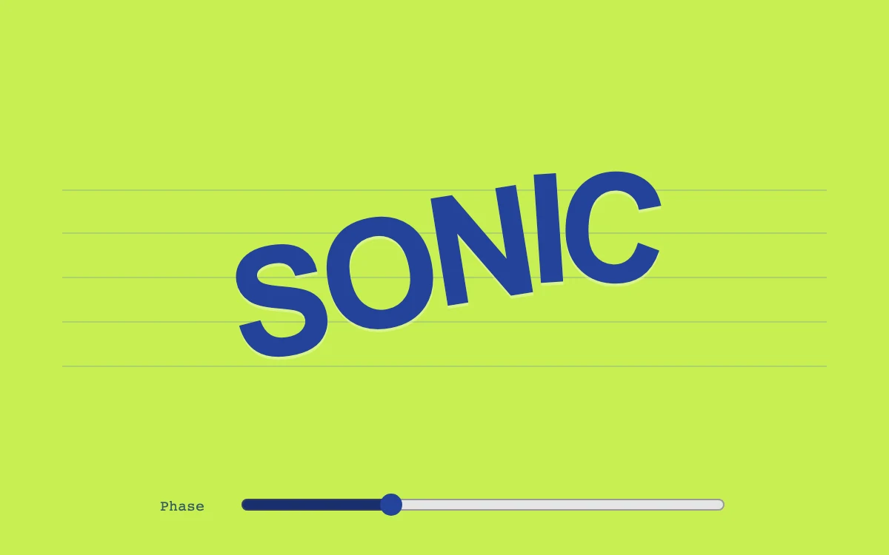

# Frequency study

> Individual letters travel along a controllable sine wave.

- **Common name:** Sine wave text
- **Category:** Animation & motion
- **Live demo:** https://www.subframe.com/motion/baseline-wave
- **Source:** Subframe (original, MIT)
- **Dependencies:** none

## Use case

Build an expressive typographic mark whose motion suggests sound or rhythm.

## Interaction

Adjust the phase

## Look

Acid lime-green field with heavy royal-blue sans capitals tilted along a curve over five faint staff lines, plus a range slider with monospace label.

## Motion

Dragging the phase slider moves each letter along a sine wave, up to 32 px vertically and 11° of tilt with per-letter offsets, eased over 120 ms.

## How to adapt

Each letter's `translateY` and `rotate` come from `Math.sin` and `Math.cos` of `i * 0.62 + phase / 12` (amplitudes 32 px and 11°); the `.wave span` transition eases it. Replace the split word, and drive `phase` from audio, scroll or time if needed.

## Reduced motion

Live reduced-motion preferences remove interpolation and decorative playback. All content and native controls remain available. Keyboard changes settle immediately.

## Limitations

Original demonstration content; adapt labels and state to the host product.

## Taxonomy

- **Components:** text, slider
- **Triggers:** drag, state
- **Techniques:** split-text, rotate
- **Feel:** playful, bold
- **Contexts:** landing, editorial
- **Tags:** typography, wave, sine, scrub, identity
- **Also known as:** wavy text, wave letters, text on a wave, per-letter wave offset
- **Surface color:** `#c8ef51`

## Code

See [`component.tsx`](component.tsx).
