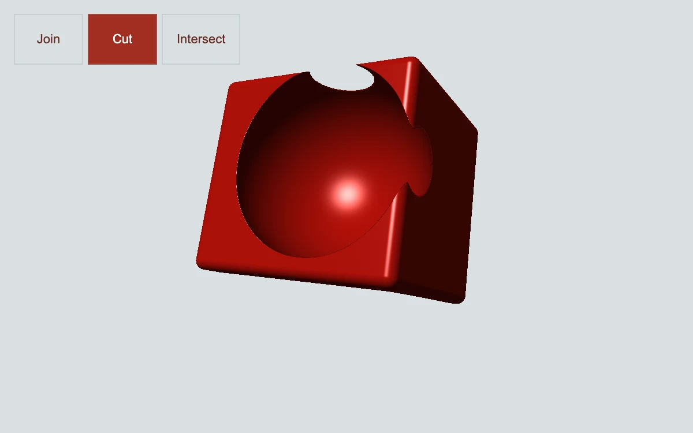

# Boolean studio

> A lacquer-red solid is joined, cut or intersected by a movable sphere.

- **Common name:** SDF raymarching shader
- **Category:** WebGL & shaders
- **Live demo:** https://www.subframe.com/motion/boolean-studio
- **Source:** Subframe (original, MIT)
- **Dependencies:** none

## Use case

Explore constructive geometry through three explicit operations and direct cutter positioning.

## Interaction

Choose Join, Cut or Intersect; drag the cutter or adjust its position.

## Look

Glossy lacquer-red rounded box with a spherical cavity and bright specular highlight on a flat pale grey-blue field; three square-cornered mode buttons top left.

## Motion

The raymarched box slowly sways while a sphere joins, cuts or intersects it per the chosen mode; dragging the canvas or slider moves the sphere sideways, reshaping the solid instantly.

## How to adapt

Geometry is the SDF in `FRAGMENT`: `box` and the sphere inside `model` combine with `min` or `max` according to `u_mode`, and `u_control` sets the sphere's x. Tune the red `vec3(.7,.065,.037)` and the sway in `local`; keep the context-loss fallback.

## Reduced motion

The elapsed-time clock stops. Parameter controls immediately update the static composition.

## Limitations

Requires WebGL 1; a static CSS swatch appears if unavailable or after context loss. Analytic box/sphere CSG with local shading, no mesh export or CAD topology.

## Taxonomy

- **Components:** scene, editor
- **Triggers:** drag, state, ambient
- **Techniques:** shader, 3d, morph
- **Feel:** technical, refined
- **Contexts:** landing, editorial
- **Tags:** native webgl, boolean, csg, sdf, raymarching, subtraction, geometry
- **Also known as:** CSG boolean demo, 3D shape subtraction, raymarched 3D object, constructive solid geometry, interactive 3D shader
- **Surface color:** `#d9e0e2`

## Code

See [`component.tsx`](component.tsx).
