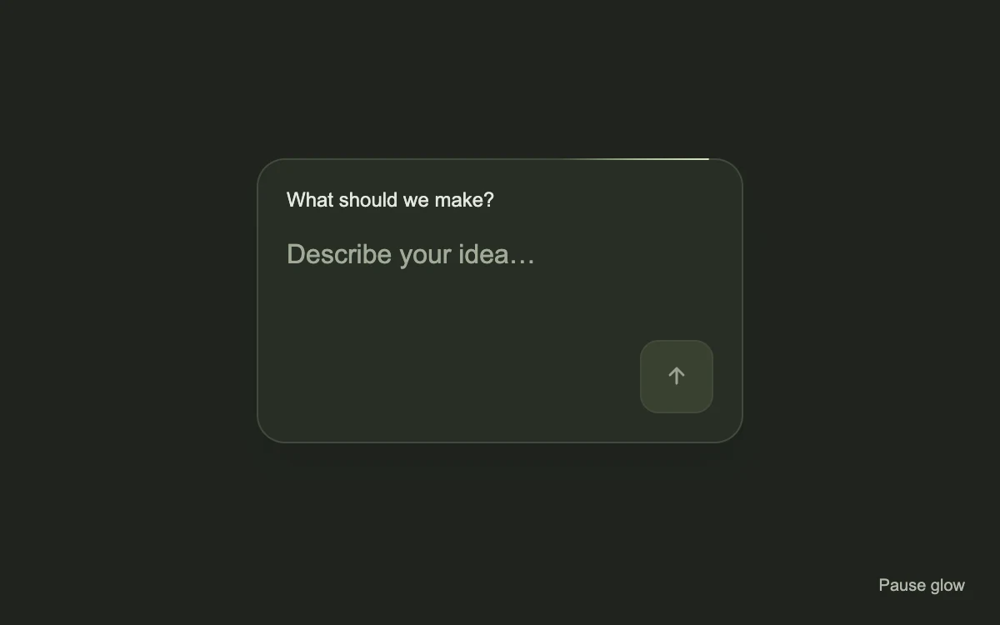

# Border beam

> A small traveling light traces the edge of a focused surface.

- **Common name:** Glowing border beam
- **Category:** Animation & motion
- **Live demo:** https://www.subframe.com/motion/border-beam
- **Source:** Magic UI (adapted, MIT) — https://magicui.design/docs/components/border-beam · [original code](https://github.com/magicuidesign/magicui/blob/85f97fd27b053339af74ba9dd4ca428ee25989fb/apps/www/registry/magicui/border-beam.tsx)
- **Dependencies:** none

## Use case

Draw attention to a single interactive area or a temporary working state, with quiet content inside.

## Interaction

Play to follow the light

## Look

Dark olive-charcoal page with a rounded, slightly lighter prompt card holding a textarea, a muted green square send button and a pale green border highlight.

## Motion

A 90 px pale-green gradient travels the card's rounded 1 px border along a CSS motion path, one linear lap every 5 s, looping until paused.

## How to adapt

The beam is `.mg-border-light` moving along `offsetPath` via the `mg-border-trace` keyframes (5s linear); its parent's `maskComposite` limits it to a 1 px ring. Match `round 17px` and `borderRadius` to your surface, tune size and gradient, and replace the idea form.

## Reduced motion

A stationary border accent replaces the traveling light.

## Limitations

Uses CSS offset-path and masking. Treat the accent as decorative, never the only status indicator.

## Taxonomy

- **Components:** card, input
- **Triggers:** ambient
- **Techniques:** glow, loop, mask
- **Feel:** subtle, refined
- **Contexts:** app, landing
- **Tags:** border, glow, loop, attention, CSS motion path
- **Also known as:** animated border glow, traveling border light, glowing card outline, AI prompt box highlight
- **Surface color:** `#24262b`

## Code

See [`component.tsx`](component.tsx).
