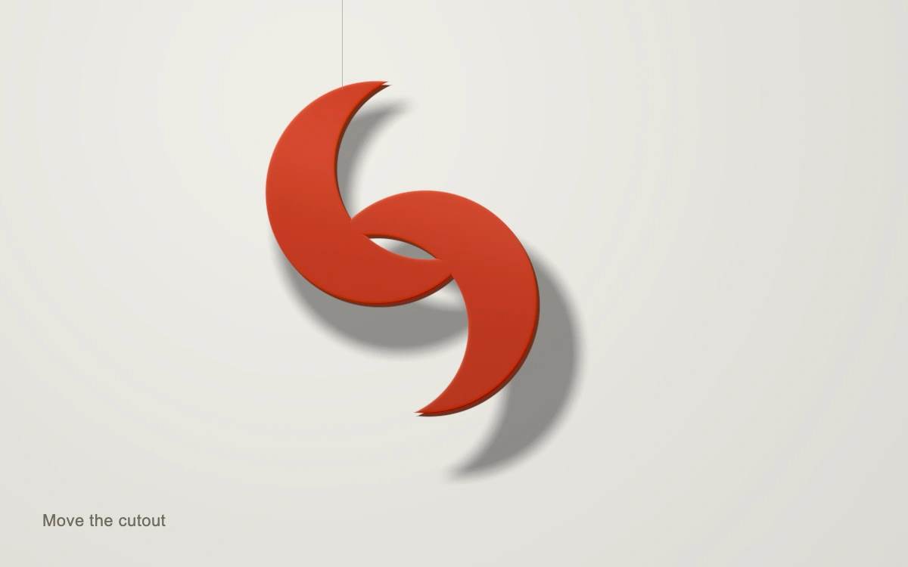

# Borrowed shadow

> A vermilion interlocked cutout hovers over ivory paper; its projected shadow follows the geometry and softens with distance.

- **Common name:** Draggable cutout with area-light shadows
- **Category:** WebGL & shaders
- **Live demo:** https://www.subframe.com/motion/borrowed-shadow
- **Source:** Subframe (original, MIT)
- **Dependencies:** none

## Use case

Give a sculptural graphic a tangible relationship to its surface in a product, identity or editorial study.

## Interaction

Drag the suspended cutout. Arrow keys move it; Home returns it to its starting position.

## Look

A lacquer-red interlocked crescent sculpture suspended by a fine wire on warm ivory, with a broad charcoal projected shadow and restrained edge highlights.

## Motion

Moving the visible cutout changes the plane intersection of rays from a fixed area source. Light size and suspension height change the penumbra; light azimuth changes its direction. The renderer is idle between changes.

## How to adapt

Use `DEFAULT_CONFIG` and the `config` prop to set light size, blocker height and azimuth. `shape` defines the original silhouette; `position` is direct-manipulation state. `useSurface` owns WebGL allocation, context restoration and demand rendering.

## Reduced motion

There is no autonomous movement or easing. Direct drag and keyboard changes redraw immediately.

## Limitations

A planar original silhouette projected onto one receiver, using bounded area-light samples; not arbitrary mesh shadow mapping or a physically calibrated lighting simulator. Requires WebGL 1; controls disable with an explicit fallback and recover after context restoration.

## Taxonomy

- **Components:** scene
- **Triggers:** drag, keyboard
- **Techniques:** shader, 3d
- **Feel:** bold, refined
- **Contexts:** landing, editorial
- **Tags:** shadow, area light, penumbra, occlusion, cutout, suspended sculpture, material, projection
- **Also known as:** soft cast shadow, area light penumbra, draggable shadow sculpture, light occluder, suspended cutout
- **Surface color:** `#e9e6dc`

## Code

See [`component.tsx`](component.tsx).
