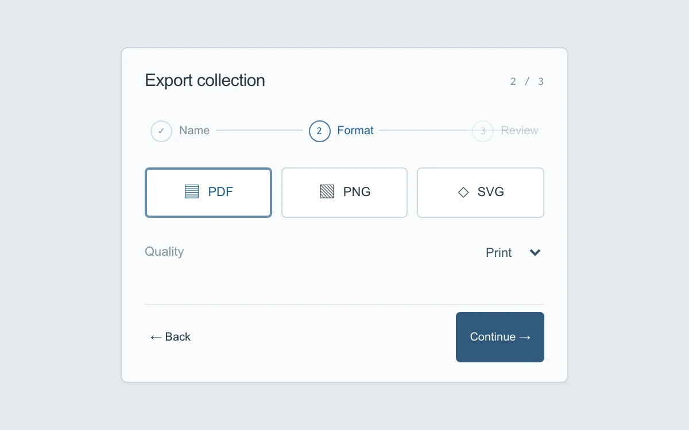

# Branch wizard

> A compact export setup preserves decisions as its panels move forward and back.

- **Common name:** Multi-step form wizard
- **Category:** Components & interactions
- **Live demo:** https://www.subframe.com/motion/branch-wizard
- **Source:** Subframe (original, MIT)
- **Dependencies:** none

## Use case

Break a small configuration task into focused, reversible steps.

## Interaction

Name the collection, choose a format and quality, review, and prepare the local preview.

## Look

Pale grey-blue page with a white bordered card holding a numbered three-step rail, outlined format tiles, a select row and a navy primary button.

## Motion

Changing step remounts the panel, fading it in as it slides 8 px from the right going forward or left going back, over 200 ms ease-out.

## How to adapt

Transitions are the `wizard-w2` keyframes on `.step` (`.2s ease-out`), re-run by the `key` on step change; `go` sets `direction`, which becomes the `--travel` offset (`direction * 8` px). Replace the three step bodies, `name` validation and the export summary.

## Reduced motion

Step changes appear immediately. Validation, retained values and focus movement remain available.

## Limitations

Local configuration preview; no files are generated.

## Taxonomy

- **Components:** form, navigation
- **Triggers:** state, press
- **Techniques:** slide, fade
- **Feel:** subtle
- **Contexts:** app
- **Tags:** wizard, multistep, validation, direction, form, reversible, export
- **Also known as:** stepper form, step-by-step setup, directional step transition, export settings flow
- **Surface color:** `#e6eaed`

## Code

See [`component.tsx`](component.tsx).
