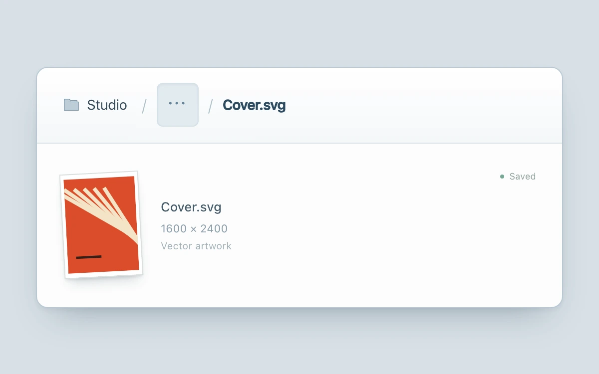

# Breadcrumb expansion

> Hidden ancestors unfold inline, keeping the current document anchored in a readable path.

- **Common name:** Collapsible breadcrumbs
- **Category:** Components & interactions
- **Live demo:** https://www.subframe.com/motion/breadcrumb-collapse
- **Source:** Subframe (original, MIT)
- **Dependencies:** none

## Use case

Reveal and navigate a compact project hierarchy without a detached parent menu.

## Interaction

Expand the ellipsis, choose an ancestor, and open its child to return. Escape collapses the trail.

## Look

Pale blue-grey page with a white rounded card: a breadcrumb bar with folder icon, slash separators and ellipsis chip, above a tilted orange cover thumbnail.

## Motion

Clicking the ellipsis widens the hidden-ancestors slot to its measured width over 280 ms ease-out as folder names fade and slide in; navigating swaps the content with a short slide-fade.

## How to adapt

Expansion is the `parent-wrap` width transition to `parentWidth` (measured from `scrollWidth` in `useLayoutEffect`) plus the `parents` fade and offset; content swaps replay `sf-path-content`. Replace `PATH` and the file detail with your hierarchy; keep the focus return in `collapse`.

## Reduced motion

Finite transitions become immediate under reduced motion and keyboard input. Host pause disables controls; any owned drag is cancelled.

## Limitations

Four local hierarchy levels with one child each; no filesystem or router integration. The original SVG cover is illustrative content.

## Taxonomy

- **Components:** navigation, disclosure
- **Triggers:** press, keyboard
- **Techniques:** layout, fade, slide
- **Feel:** subtle
- **Contexts:** app
- **Tags:** breadcrumb, navigation, inline-expansion, hierarchy, folder, measured-layout, focus-return
- **Also known as:** breadcrumb overflow, truncated breadcrumb trail, ellipsis breadcrumb, expandable file path
- **Surface color:** `#d8e0e6`

## Code

See [`component.tsx`](component.tsx).
