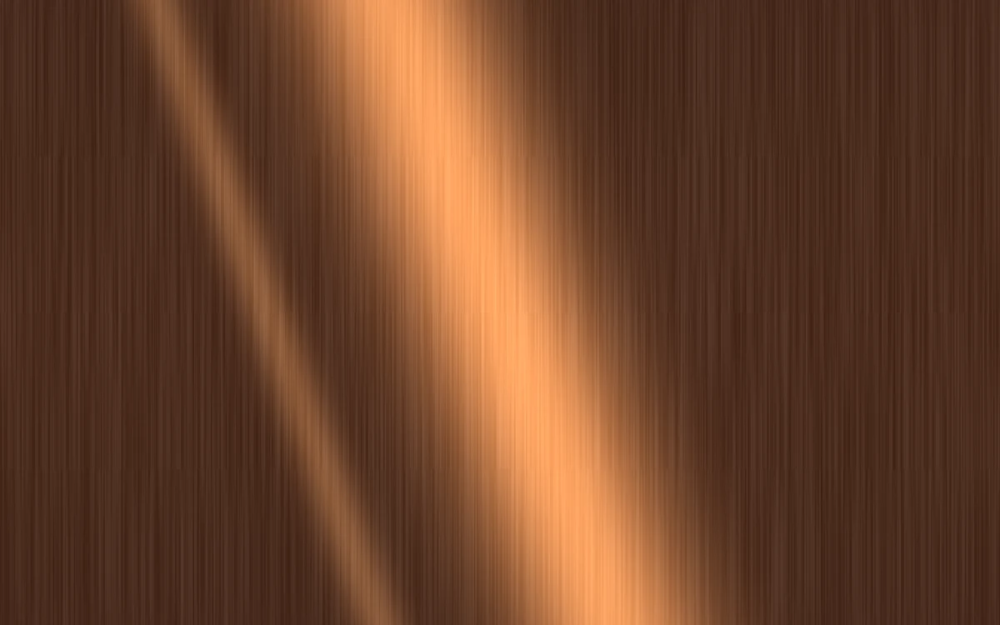

# Brushed alloy

> Machined copper catches a rotating pair of elongated highlights.

- **Common name:** Brushed metal shader
- **Category:** WebGL & shaders
- **Live demo:** https://www.subframe.com/motion/brushed-alloy
- **Source:** Subframe (original, MIT)
- **Dependencies:** none

## Use case

A material swatch for hardware, audio products, and industrial design systems.

## Interaction

Adjust light angle

## Look

Full-bleed dark brown copper surface with fine vertical brushed streaks and two soft diagonal peach-orange highlight bands, one broad and one narrow.

## Motion

The paired highlight bands rotate slowly around the centre at 0.07 rad/s, about 90 s per turn, over static brush grain; the light-angle slider offsets them through a full turn.

## How to adapt

In the `FRAGMENT` shader, `a` (`u_control*6.28+u_time*.07`) sets the highlight direction, `light` and `second` are the two Gaussian streaks, and `brush` is the grain. Recolour the copper via the `vec3` terms in `c`; keep the context-loss and reduced-motion handling.

## Reduced motion

A representative frame remains still. Live system preference changes immediately stop the loop; the range control continues to update the still image.

## Limitations

Requires WebGL 1. A static CSS fallback appears when unavailable or after context loss. An analytic anisotropic material impression; no measured BRDF, environment map, or imported model.

## Taxonomy

- **Components:** background
- **Triggers:** ambient, state
- **Techniques:** shader, glow, noise
- **Feel:** refined, calm
- **Contexts:** landing, editorial
- **Tags:** metal, anisotropic, brushed, copper, machined, native webgl
- **Also known as:** copper metal texture, metallic sheen background, anisotropic highlight, machined metal swatch
- **Surface color:** `#66402e`

## Code

See [`component.tsx`](component.tsx).
