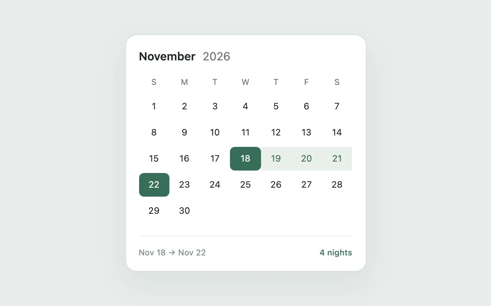

# Calendar range

> Select a short stay with a continuous, legible date range.

- **Common name:** Date range picker
- **Category:** Components & interactions
- **Live demo:** https://www.subframe.com/motion/calendar-range
- **Source:** Subframe (original, MIT)
- **Dependencies:** none

## Use case

Select a short stay with a continuous, legible date range.

## Interaction

Choose arrival and departure dates

## Look

Pale grey-green page with a white rounded calendar card: bold month heading, seven-column day grid, deep green endpoint chips and a mint band between.

## Motion

Clicking a start then an end date fills the range: endpoints turn deep green and in-between days mint, each cell's background and text colour transitioning over 140 ms.

## How to adapt

Selection logic is `choose` (a click after a complete range, or before `from`, restarts it); cells get `first`, `middle` and `last` classes whose 140 ms background transition is the only motion. Replace the fixed 30-day November grid with real dates and availability.

## Reduced motion

Live system preference disables decorative motion; all controls remain usable. Keyboard actions settle immediately.

## Limitations

A fixed November 2026 calendar; dates, locale, availability, and persistence belong to the host application.

## Taxonomy

- **Components:** picker
- **Triggers:** press, state
- **Techniques:** fade
- **Feel:** subtle
- **Contexts:** app
- **Tags:** calendar, date range, booking, selection
- **Also known as:** booking calendar, check-in check-out picker, date range selector, stay dates calendar
- **Surface color:** `#edf0f3`

## Code

See [`component.tsx`](component.tsx).
