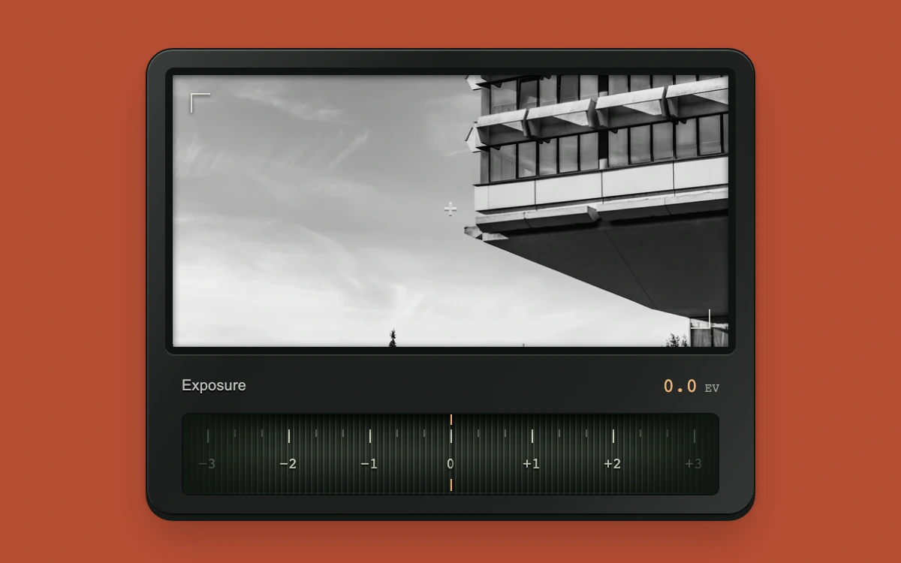

# Exposure wheel

> A knurled exposure ring changes the brightness of an architectural photograph in precise one-third-stop increments.

- **Common name:** Exposure dial control
- **Category:** Components & interactions
- **Live demo:** https://www.subframe.com/motion/camera-wheel
- **Source:** Subframe (original, MIT)
- **Dependencies:** none

## Use case

Compact relative scrubbing controls for photographic adjustments, with a fixed index and immediate visual feedback.

## Interaction

Drag the wheel or adjust exposure with arrow keys.

## Look

Dark graphite camera body with a black-and-white architectural photo and a knurled tick-scale wheel with an amber index, on a flat burnt-orange background.

## Motion

Dragging the wheel horizontally slides its knurl and tick scale under a fixed amber index, snapping to one-third stops while the photo's brightness follows 2^EV; arrow keys step instantly.

## How to adapt

Drag mapping is in `onPointerMove` (54 px per stop; `limit` snaps to thirds and clamps ±3), and `ev` drives the strip offsets and the `brightness` filter. Replace the image `src` and point `ev` at your own setting.

## Reduced motion

The wheel, index and photograph respond immediately to all input; no inertial or automatic motion runs.

## Limitations

The sample JPEG-derived WebP is multiplied with CSS brightness using 2^EV. This is a display approximation, not linear RAW exposure processing; clipped image detail cannot be recovered. Sample photograph is separately licensed under Unsplash.

## Taxonomy

- **Components:** slider, image
- **Triggers:** drag, keyboard
- **Techniques:** slide
- **Feel:** technical, refined
- **Contexts:** app
- **Tags:** camera, exposure, scrub, wheel, numeric, photography, material, EV, relative drag
- **Also known as:** scrubbing ruler slider, camera dial input, horizontal scrub wheel, photo brightness control, tick ruler slider
- **Surface color:** `#b64e35`

## Assets

- [`concrete-projections.webp`](../../assets/concrete-projections.webp) — Brutalist concrete office building (Unsplash)

## Code

See [`component.tsx`](component.tsx).
