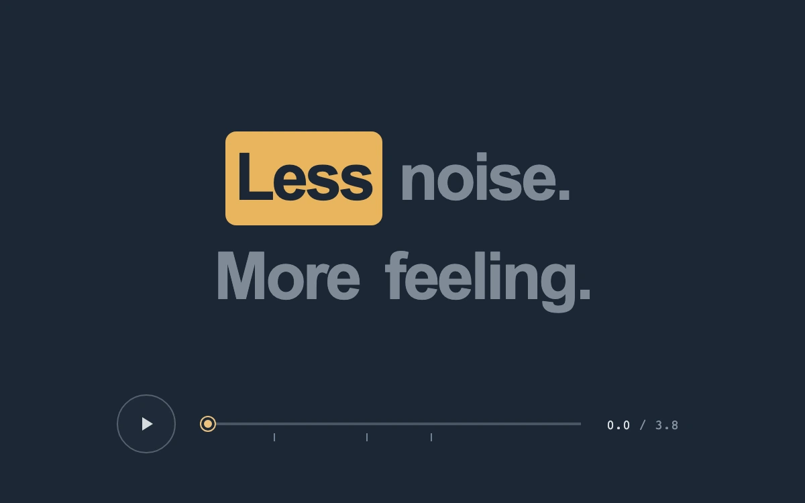

# Say it with rhythm

> A warm highlight follows a two-line phrase along a continuous, deliberately paced timeline.

- **Common name:** Karaoke caption highlight
- **Category:** Animation & motion
- **Live demo:** https://www.subframe.com/motion/caption-beats
- **Source:** Subframe (original, MIT)
- **Dependencies:** none

## Use case

Preview timed caption emphasis, lyric pacing or spoken-text motion before connecting media.

## Interaction

Play or pause the phrase, or scrub to an exact time.

## Look

Slate-navy page with a bold two-line sans-serif phrase in muted grey, one word on an amber rounded highlight, above a round play button and scrubber.

## Motion

Playing runs a 3.8 s timeline; at each authored beat an amber block slides and resizes onto the next word (350 ms ease-out), whose text darkens; scrubbing snaps it instantly.

## How to adapt

Timing lives in `WORDS`, `BEATS` and `DURATION`; a `requestAnimationFrame` loop advances `time`. On each word change, measured bounds place `sf-cb-highlight` with translate; its fill scales horizontally between fixed rounded ends. The visible progress and thumb use transforms, while the semantic range input handles seeking. Replace the arrays and caption's `aria-label` with real word timings; preserve pointer and keyboard synchronization.

## Reduced motion

No automatic playback; the play control advances one word per activation. Scrubbing still selects exact times without moving the highlight.

## Limitations

A local 3.8-second timing study with authored word boundaries; no audio, transcription or alignment service.

## Taxonomy

- **Components:** text, media
- **Triggers:** press, drag
- **Techniques:** slide, morph
- **Feel:** refined, bold
- **Contexts:** editorial, landing
- **Tags:** caption, typography, rhythm, highlight, timing, scrub, playback, text
- **Also known as:** word-by-word captions, lyric highlight, timed subtitle emphasis, synced transcript highlight
- **Surface color:** `#1c2735`

## Code

See [`component.tsx`](component.tsx).
