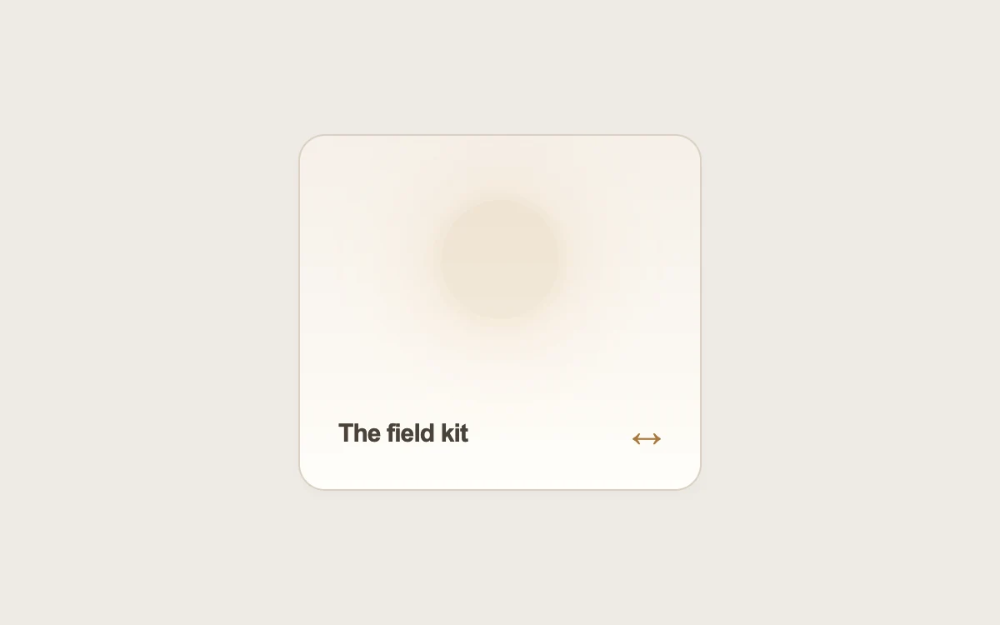

# The other side

> A quiet front turns to reveal a little more, with details following the card's movement.

- **Common name:** 3D card flip
- **Category:** Components & interactions
- **Live demo:** https://www.subframe.com/motion/card-flip
- **Source:** Kokonut UI (adapted, MIT) — https://kokonutui.com/docs/components/card-flip · [original code](https://github.com/kokonut-labs/kokonutui/blob/83eec6d982d400a18438001a8efdbac1f159dd43/components/kokonutui/card-flip.tsx)
- **Dependencies:** none

## Use case

Present an optional second layer of information on a compact exploratory card.

## Interaction

Hover or tap the card; keyboard users can press Enter

## Look

Warm beige page with a single rounded cream card, a soft blurred amber glow at its centre, a dark bold title and bronze double arrow.

## Motion

Hover or tap flips the card in 3D over 500 ms ease-in-out; back lines slide and fade in 50 ms apart; front glow discs pulse in a 3 s loop.

## How to adapt

The flip is `sf-flip-card` toggled by `data-flipped` (`rotateY` with a 500 ms transition and `backface-visibility`); back items use inline `transitionDelay`, front pulses use the `sf-flip-scale` keyframes. Replace the front title and the three feature strings; keep the button for touch and keyboard.

## Reduced motion

The two faces switch without rotation. Decorative pulses and stagger travel stop.

## Limitations

Keep essential information outside a hover-only reveal. This version also supports a native button's touch and keyboard activation.

## Taxonomy

- **Components:** card
- **Triggers:** hover, press, ambient
- **Techniques:** rotate, 3d, stagger, glow
- **Feel:** refined, calm
- **Contexts:** landing, app
- **Tags:** card, hover, click, flip, 3D, perspective, stagger, CSS, pulse
- **Also known as:** flip card on hover, double-sided card, card back reveal, rotate to reveal details
- **Surface color:** `#efebe5`

## Code

See [`component.tsx`](component.tsx).
