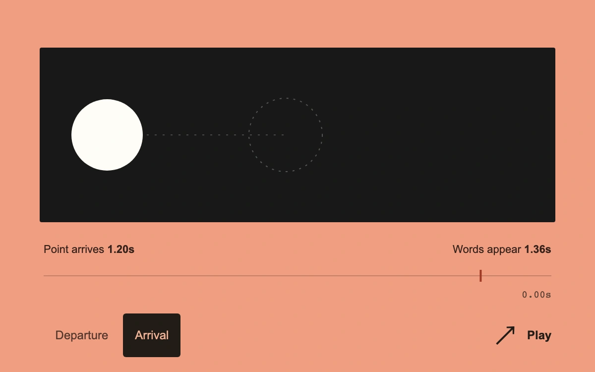

# Causal cadence

> A white point crosses a black strip while a caption follows either its departure or its arrival.

- **Common name:** Event-relative animation timing
- **Category:** Animation & motion
- **Live demo:** https://www.subframe.com/motion/causal-cadence
- **Source:** Subframe (original, MIT)
- **Dependencies:** none

## Use case

Specify whether a secondary animation should follow the start or the completion of an earlier action.

## Interaction

Choose Departure or Arrival to start a sequence, then replay or pause it. Compare the displayed cue times.

## Look

A large white point and a two-line white caption occupy a black strip on salmon, above a thin time rail and spare native sequence controls.

## Motion

Play moves the point with a cubic ease-out. In Departure mode the caption begins after the chosen delay from zero; in Arrival mode it begins after travel completes plus that delay. Host pause and hidden documents freeze elapsed time.

## How to adapt

`cueAt` derives the caption start from the selected `mode`, `travelDuration`, and `captionOffset`; `paint` maps elapsed time to point position and caption opacity. Replace the caption artwork, and tune `travelDuration`, `captionDuration`, or `travelDistance` for your sequence.

## Reduced motion

Play and mode changes immediately display the final point and caption together with their event timestamps.

## Limitations

An authored two-event sequence, not a timeline editor or dependency scheduler. Timing controls are captured on the next Play or mode selection; travel distance updates live.

## Taxonomy

- **Components:** scene, text, button
- **Triggers:** press, keyboard
- **Techniques:** slide, fade
- **Feel:** bold, technical
- **Contexts:** app, editorial
- **Tags:** sequence, choreography, timing, caption, event relative, finite animation, SVG
- **Also known as:** animation sequence offset, start versus finish timing, caption choreography, completion-relative delay
- **Surface color:** `#f09d81`

## Code

See [`component.tsx`](component.tsx).
