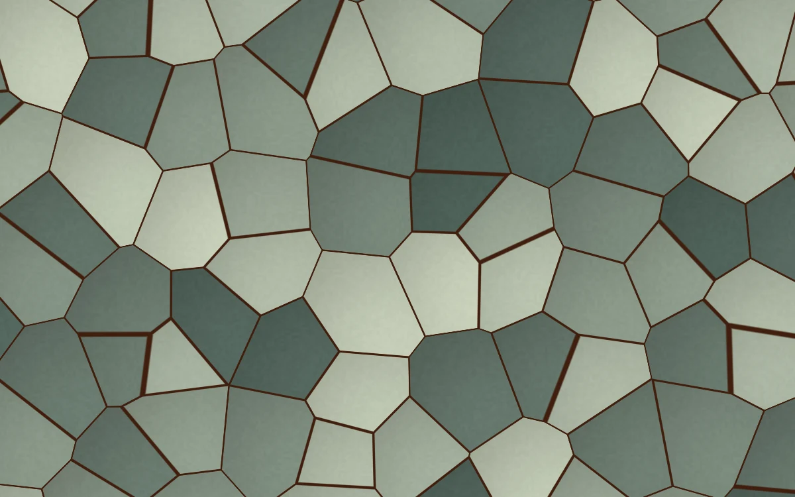

# Cellular stone

> Copper seams settle between softly lit mineral cells.

- **Common name:** Voronoi stone shader
- **Category:** WebGL & shaders
- **Live demo:** https://www.subframe.com/motion/cellular-stone
- **Source:** Subframe (original, MIT)
- **Dependencies:** none

## Use case

A mineral surface for architecture, materials collections, and spatial identities.

## Interaction

Adjust cell scale

## Look

Tessellated sage, slate-green and pale grey-green polygon cells with subtle grain and shading, divided by thin dark copper-brown seams, filling the frame.

## Motion

Voronoi seed points drift slowly on sine paths, so cell boundaries and copper seams continuously reshape; the cell scale slider sets four to eight cells across the short side.

## How to adapt

The pattern is `FRAGMENT`: cell density `4.0+u_control*4.0`, seed drift `.34*sin(rnd*6.28+u_time*.09)`, seam width `smoothstep(.015,.035,second-first)` and the stone and copper `vec3` colours. Keep the canvas lifecycle, pause button and fallback.

## Reduced motion

A representative frame remains still. Live system preference changes immediately stop the loop; the range control continues to update the still image.

## Limitations

Requires WebGL 1. A static CSS fallback appears when unavailable or after context loss. The cells deform slowly; this is an invented mineral texture rather than scanned stone.

## Taxonomy

- **Components:** background
- **Triggers:** ambient
- **Techniques:** shader, noise, morph
- **Feel:** calm, refined
- **Contexts:** landing, editorial
- **Tags:** voronoi, stone, mineral, facets, cellular, native webgl
- **Also known as:** voronoi pattern background, cell mosaic texture, flagstone pattern, worley noise shader
- **Surface color:** `#b2ada3`

## Code

See [`component.tsx`](component.tsx).
