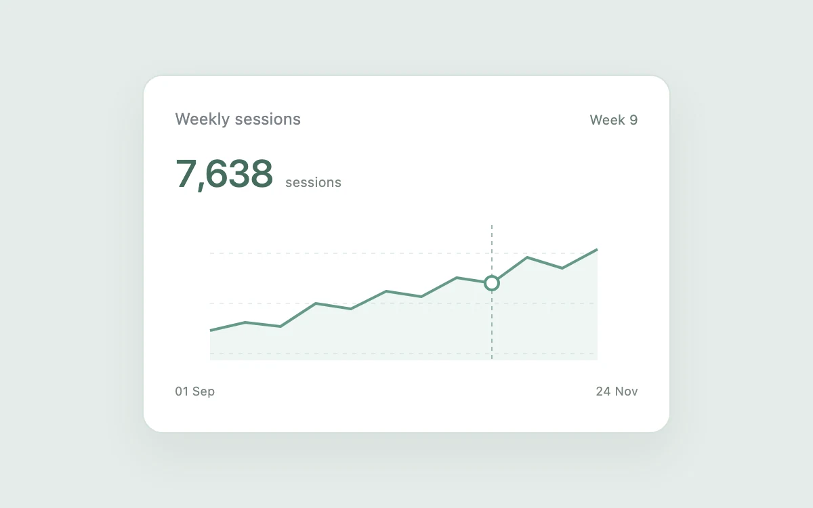

# Chart crosshair

> Read an individual point accurately while retaining the shape of the series.

- **Common name:** Chart crosshair tooltip
- **Category:** Components & interactions
- **Live demo:** https://www.subframe.com/motion/chart-crosshair
- **Source:** Subframe (original, MIT)
- **Dependencies:** none

## Use case

Read an individual point accurately while retaining the shape of the series.

## Interaction

Inspect a data point

## Look

White rounded card on pale sage: a large dark-green figure above a thin green line chart with faint area fill, dashed gridlines and crosshair.

## Motion

Moving the pointer, dragging on touch, or pressing arrow, Home and End snaps a dashed crosshair and ringed marker to the nearest weekly point, updating the value instantly.

## How to adapt

`inspect` converts pointer x into the nearest `index` (points sit 26 units apart in a 310-wide `viewBox`), which positions the crosshair and marker; keys call `setIndex`. Replace `values`, the 134 multiplier and the axis dates with your series.

## Reduced motion

Live system preference disables decorative motion; all controls remain usable. Keyboard actions settle immediately.

## Limitations

Twelve fixed weeks of sample data; keyboard arrows, Home, and End inspect the same points as the pointer.

## Taxonomy

- **Components:** chart, tooltip
- **Triggers:** pointer, keyboard, drag
- **Techniques:** path
- **Feel:** technical, subtle
- **Contexts:** dashboard, app
- **Tags:** chart, crosshair, tooltip, data, analytics
- **Also known as:** line chart hover, chart scrubber, data point inspector, interactive line chart, hover value readout
- **Surface color:** `#edf0f3`

## Code

See [`component.tsx`](component.tsx).
