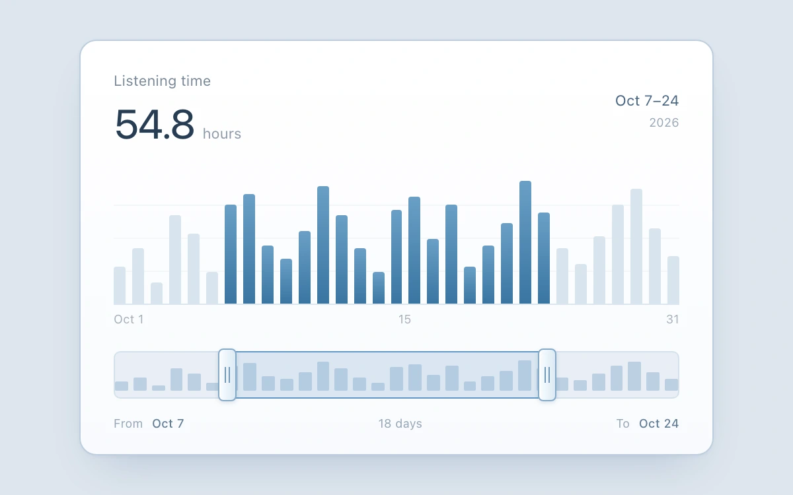

# Chart range brush

> Independent endpoints select listening days on one fixed-scale minimap.

- **Common name:** Time series range slider
- **Category:** Components & interactions
- **Live demo:** https://www.subframe.com/motion/chart-range-brush
- **Source:** Subframe (original, MIT)
- **Dependencies:** none

## Use case

Inspect a date interval without shifting the opposite endpoint or losing the full series.

## Interaction

Drag either minimap handle, or use arrow keys, Home/End and PageUp/PageDown. Escape cancels the drag.

## Look

Pale blue-grey page with a white rounded card holding a large total, a steel-blue bar chart and a minimap track with two grip handles.

## Motion

Dragging either minimap handle snaps it day by day while the selected window, highlighted bars, total and dates update directly; Escape mid-drag restores the previous range.

## How to adapt

Range logic is `update` (clamps so endpoints never cross) and `finish` (restores `origin` on cancel); handle drags map pointer x to whole days through `grab`. Replace `HOURS`, the hard-coded `30` index range and the October labels with your series and dates.

## Reduced motion

Finite transitions become immediate under reduced motion and keyboard input. Host pause disables controls; any owned drag is cancelled.

## Limitations

Illustrative 31-day series. Minimum interval spans two inclusive days; endpoints cannot cross. No window panning, zoom or real listening data.

## Taxonomy

- **Components:** chart, slider
- **Triggers:** drag, keyboard
- **Techniques:** slide, gradient
- **Feel:** technical, subtle
- **Contexts:** dashboard, app
- **Tags:** chart, brush, range, dual-handle, fixed-domain, time-series, minimap, pointer-capture
- **Also known as:** date range brush, dual handle minimap, chart window selector, timeline range picker
- **Surface color:** `#dde5ee`

## Code

See [`component.tsx`](component.tsx).
