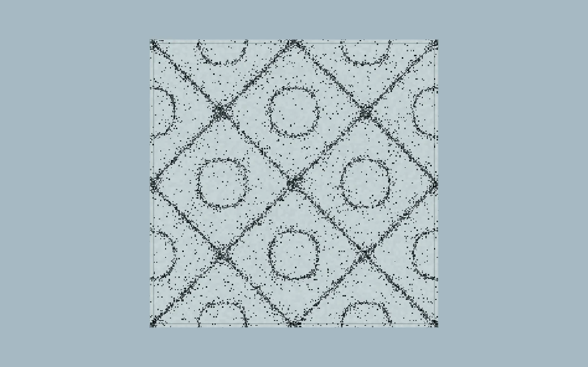

# Chladni plate

> Granular dark nodes gather into the standing-wave patterns of a pale steel plate.

- **Common name:** Cymatics particle shader
- **Category:** WebGL & shaders
- **Live demo:** https://www.subframe.com/motion/chladni-plate
- **Source:** Subframe (original, MIT)
- **Dependencies:** none

## Use case

Make resonance structure visible through discrete plate modes.

## Interaction

Adjust mode.

## Look

Square pale steel plate on dusty blue-grey, speckled with dark grain that collects into crossing diagonal lines and rings, with a thin inset rim.

## Motion

Dark grains thicken and thin along the standing-wave nodal lines in a slow pulse of about 9.5 s; the mode slider snaps the plate to discrete patterns; a button pauses.

## How to adapt

The pattern is the `FRAGMENT` shader: `u_control` picks integer `mode` and `b` for `wave`, `nodes` sets line sharpness and its `sin(u_time*.33)` pulse, and `salt` sets grain density. Recolour `bg` and `metal`; keep the canvas lifecycle and fallback.

## Reduced motion

The elapsed-time clock stops. Parameter controls immediately update the static composition.

## Limitations

Requires WebGL 1; a static CSS swatch appears if unavailable or after context loss. Analytic nodal amplitude with deterministic grain, not a sand particle simulation or audio input.

## Taxonomy

- **Components:** background, scene
- **Triggers:** ambient, state
- **Techniques:** shader, particles, noise
- **Feel:** technical, calm
- **Contexts:** editorial, landing
- **Tags:** native webgl, chladni, standing waves, resonance, nodal, granular
- **Also known as:** standing wave pattern, vibrating sand plate, resonance pattern, nodal line visual
- **Surface color:** `#bacbd1`

## Code

See [`component.tsx`](component.tsx).
