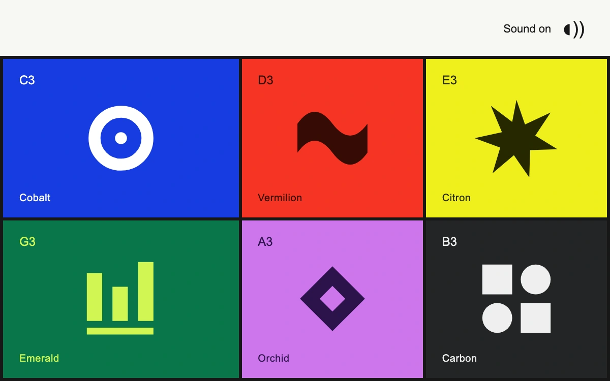

# Chromatic sampler

> Six graphic pads invert their ink, depress on contact and play six distinct synthesized notes.

- **Common name:** Sound pad buttons
- **Category:** Components & interactions
- **Live demo:** https://www.subframe.com/motion/chromatic-sampler
- **Source:** Subframe (original, MIT)
- **Dependencies:** none

## Use case

Immediate musical feedback for playable brand identities, creative toys and compact sample pads.

## Interaction

Press a pad, use keys 1–6, or toggle sound.

## Look

Six flat saturated colour tiles in a black-gridded two-row layout, each with a bold geometric glyph, small note label and name, under an off-white header.

## Motion

Pressing a pad or keys 1–6 nudges its face 5 px down-right in 110 ms and inverts its colours for 180 ms while Web Audio plays a short synthesized note.

## How to adapt

Pad data lives in `PADS` (name, note, `hz`, colours, `wave`); `play` starts an oscillator with an 8 ms attack and 0.44 s exponential decay and holds `pressed` for 180 ms. The press offset is `translate(5px,5px)` on `.sf-cs-face`; replace glyphs and names.

## Reduced motion

Graphic ink inversion remains immediate; press displacement is removed. Audio still plays after a user gesture.

## Limitations

Sound is armed initially and starts on the first pad gesture, subject to browser audio support. Six synthesized pitches, not recorded samples or a sequencer.

## Taxonomy

- **Components:** button, media
- **Triggers:** press, keyboard
- **Techniques:** slide
- **Feel:** playful, bold
- **Contexts:** landing, editorial
- **Tags:** audio, web-audio, sampler, synthesizer, sound, graphic, pad, press, keyboard
- **Also known as:** drum pad grid, soundboard, synth pad buttons, playable colour tiles, sample pad launcher
- **Surface color:** `#f7f7f2`

## Code

See [`component.tsx`](component.tsx).
