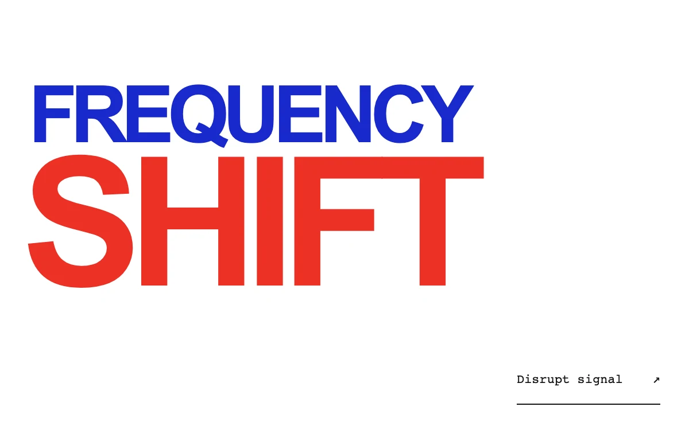

# Chromatic signal

> Cobalt and vermilion type briefly split into clipped, displaced channels before returning to a clean headline.

- **Common name:** Glitch text effect
- **Category:** Animation & motion
- **Live demo:** https://www.subframe.com/motion/chromatic-signal
- **Source:** Subframe (original, MIT)
- **Dependencies:** none

## Use case

A finite signal interruption for display typography.

## Interaction

Press Disrupt signal.

## Look

Pure white page with heavy, tightly tracked sans-serif display type, a cobalt line over a much larger vermilion line, and a small underlined monospace button.

## Motion

Pressing the button runs a 480 ms stepped glitch: cobalt and vermilion copies of each line flash in clipped horizontal slices, jumping sideways up to 11 px, then vanish.

## How to adapt

The glitch is `:before`/`:after` copies built from `data-text` that run `sf-cs-break-a` and `sf-cs-break-b` (480 ms, `steps(1,end)`, `clip-path` slices plus `translateX`) while `data-pulse` is true; `disrupt` re-keys and times it. Replace the words and their `data-text` copies together.

## Reduced motion

The control briefly changes color; the headline stays intact.

## Limitations

An authored 480ms text effect; not a live audio signal.

## Taxonomy

- **Components:** text
- **Triggers:** press
- **Techniques:** mask, distortion
- **Feel:** bold
- **Contexts:** landing, editorial
- **Tags:** text, glitch, chromatic, clip-path, overprint, finite, typography
- **Also known as:** RGB split text, chromatic aberration text, glitch headline, signal interference effect
- **Surface color:** `#ffffff`

## Code

See [`component.tsx`](component.tsx).
