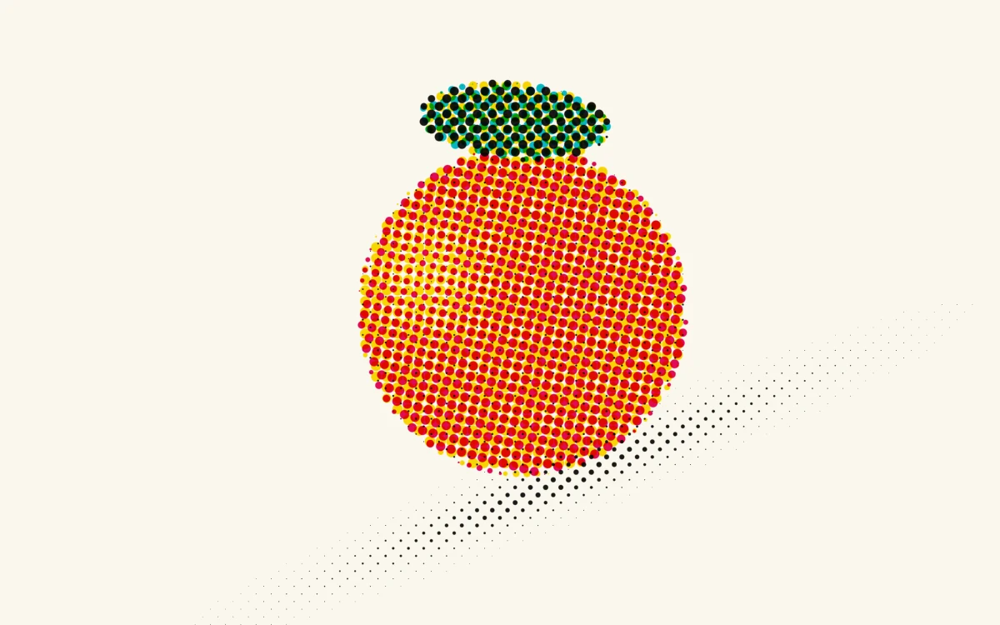

# CMYK proof

> A printed citrus study separates into four angled screens as its color plates slip out of register.

- **Common name:** CMYK halftone shader
- **Category:** WebGL & shaders
- **Live demo:** https://www.subframe.com/motion/cmyk-proof
- **Source:** Subframe (original, MIT)
- **Dependencies:** none

## Use case

Refine subtractive print texture through independent ink-screen alignment.

## Interaction

Adjust registration.

## Look

Cream paper with a red-orange citrus and green leaf rendered as coarse cyan, magenta, yellow and black halftone dots, with a dotted diagonal shadow.

## Motion

The citrus artwork rotates at 0.08 rad/s beneath four fixed, differently angled dot screens; the registration slider shifts the cyan, magenta and yellow plates apart.

## How to adapt

All drawing is in the `FRAGMENT` shader: `artwork` is the procedural citrus (turning at `u_time*.08`), `ink` builds each angled dot screen, and `u_control` scales the plate offsets. Swap `artwork` for your own illustration or texture lookup; keep the context-loss and reduced-motion handling.

## Reduced motion

The elapsed-time clock stops. Parameter controls immediately update the static composition.

## Limitations

Requires WebGL 1; a static CSS swatch appears if unavailable or after context loss. Original procedural still life; four screen approximation without ICC color management.

## Taxonomy

- **Components:** image, background
- **Triggers:** ambient, state
- **Techniques:** shader, noise, rotate
- **Feel:** technical, calm
- **Contexts:** landing, editorial
- **Tags:** native webgl, cmyk, halftone, registration, print, subtractive, color separation
- **Also known as:** halftone effect, CMYK print effect, color separation shader, print misregistration, pop art dots
- **Surface color:** `#f7f5e9`

## Code

See [`component.tsx`](component.tsx).
