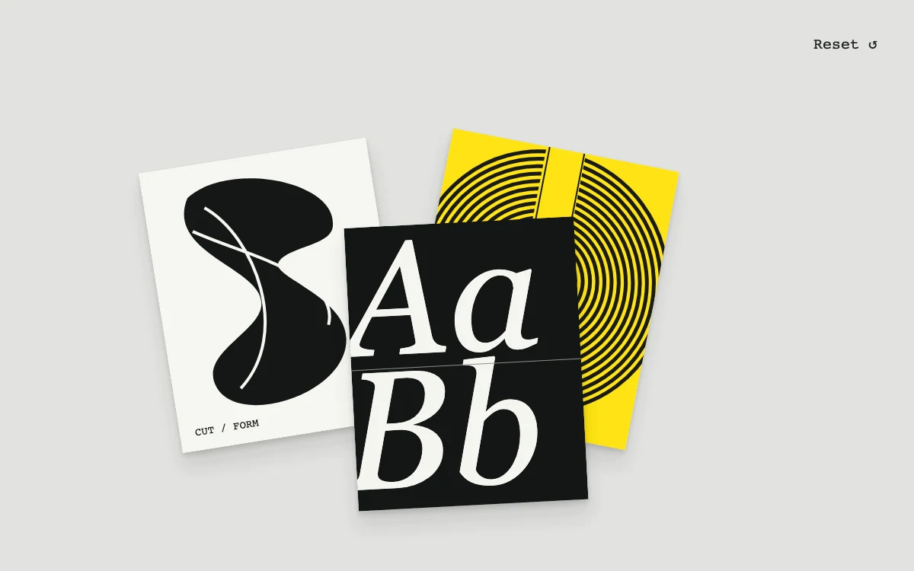

# Collage board

> Three original graphic studies can be moved into a persistent, overlapping composition.

- **Common name:** Draggable collage board
- **Category:** Components & interactions
- **Live demo:** https://www.subframe.com/motion/collage-board
- **Source:** Subframe (original, MIT)
- **Dependencies:** none

## Use case

Freeform visual arrangement in a compact board.

## Interaction

Drag a study, or focus it and use arrow keys.

## Look

Light grey board with three tilted, overlapping poster cards: black blob on off-white, black rings on yellow, and white italic serif letters on black.

## Motion

Grabbing a card brings it to the front and deepens its shadow over 140 ms while it follows the pointer within the board; arrow keys nudge it 2.5%.

## How to adapt

Positions are normalised `pieces` updated by `move` (clamped to the board, bottom limit 0.88); `selected` sets `zIndex` and `data-dragging` triggers the deeper `box-shadow`. Replace the three inline SVG studies and `names`, and persist `pieces` if needed.

## Reduced motion

Positions change directly; raised shadow feedback is removed.

## Limitations

Three local SVG studies; no image import or saved composition.

## Taxonomy

- **Components:** gallery, editor
- **Triggers:** drag, keyboard
- **Techniques:** slide, layout
- **Feel:** playful
- **Contexts:** editorial, app
- **Tags:** collage, drag, composition, canvas, arrange, z-index, editorial
- **Also known as:** moodboard, drag and drop canvas, freeform arrangement board, draggable cards, pinboard
- **Surface color:** `#e1e2df`

## Code

See [`component.tsx`](component.tsx).
