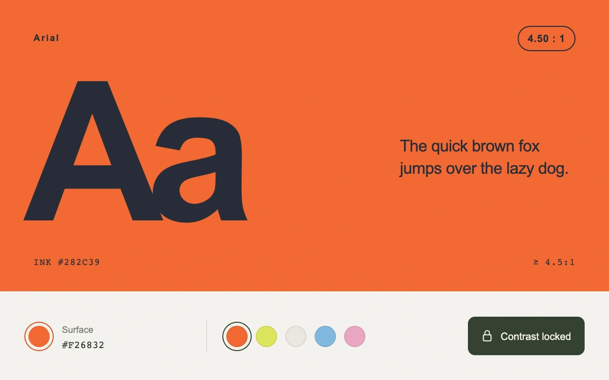

# Keep the pair readable

> A color proof recomputes its paired ink as the surface changes, preserving an unrounded contrast target within a bounded palette.

- **Common name:** Contrast-locked color pair
- **Category:** Components & interactions
- **Live demo:** https://www.subframe.com/motion/color-contrast-lock
- **Source:** Subframe (original, MIT)
- **Dependencies:** none

## Use case

Explore theme colors while preserving a text contrast relationship, or show why a restricted palette cannot meet it.

## Interaction

Choose a surface swatch or open the color well. Lock contrast to recompute ink; unlock it to keep the ink fixed as the surface changes.

## Look

Full-bleed persimmon Arial specimen with oversized Aa, a small pangram, exact ink value and a neutral color-mixing strip.

## Motion

A surface edit recomputes and applies the paired ink immediately. Unlocking freezes the current ink; relocking resolves from the newest surface. The ratio display floors to two decimals instead of rounding a failing pair up.

## How to adapt

`luminance` and `contrast` implement the sRGB contrast calculation. `solveInk` finds a bounded foreground on the fixed `ink` axis. Change `SWATCHES` for surface presets, and `DEFAULT_CONFIG` or the `config` prop for the minimum ratio and palette limits.

## Reduced motion

Every color edit applies immediately; no hue tween passes through unverified intermediate contrasts. Inactive hosts disable all inputs.

## Limitations

sRGB WCAG contrast calculation, not APCA or a full accessibility audit. Ink is searched on a fixed 225-degree, 18%-saturation HSL axis in 1,001 samples. Impossible polarity or lightness bounds show an explicit unavailable state.

## Taxonomy

- **Components:** picker, toggle, text
- **Triggers:** press, keyboard, state
- **Feel:** bold, refined
- **Contexts:** app, dashboard
- **Tags:** color, contrast, paired color, accessibility, WCAG, palette, solver, typography, constraint
- **Also known as:** paired color solver, contrast lock, accessible color pair, automatic foreground color, WCAG color picker
- **Surface color:** `#f26832`

## Code

See [`component.tsx`](component.tsx).
