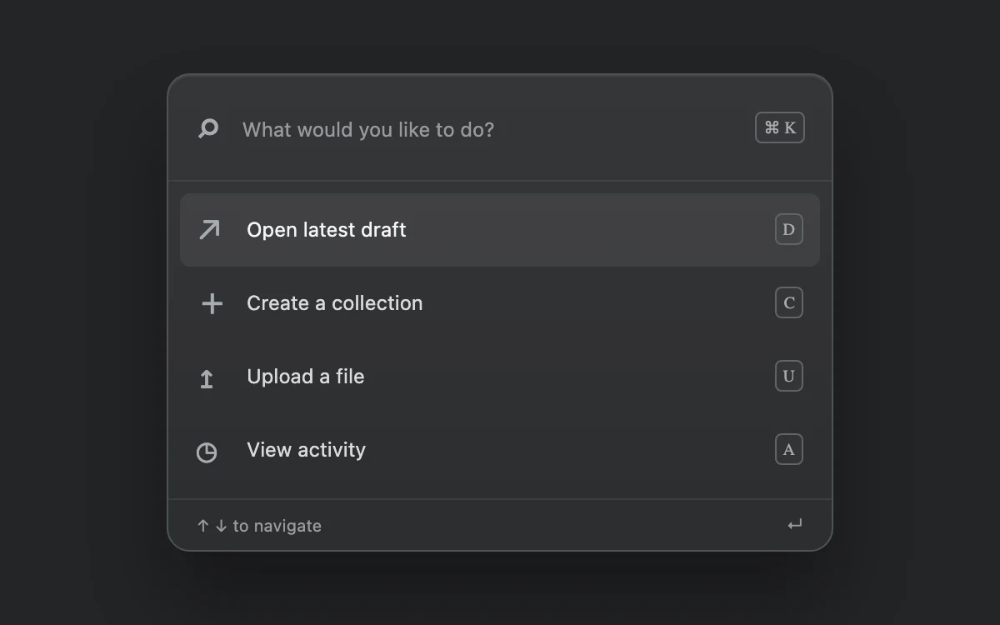

# Command launcher

> Filter actions and navigate results immediately from the keyboard.

- **Common name:** Command palette
- **Category:** Components & interactions
- **Live demo:** https://www.subframe.com/motion/command-launcher
- **Source:** Subframe (original, MIT)
- **Dependencies:** none

## Use case

Filter actions and navigate results immediately from the keyboard.

## Interaction

Search for a command

## Look

Charcoal page with a graphite rounded panel: search field, four icon-led action rows with letter keycaps, the first highlighted, and a small hint footer.

## Motion

No transitions: typing filters the actions instantly, arrow keys or pointer movement jump the highlight between rows, Enter or click shows the choice in the footer, Escape clears.

## How to adapt

Filtering is `list` (substring match on `query`), the highlight is `index` reflected in `aria-selected` and `aria-activedescendant`, and `onKeyDown` handles arrows, Enter and Escape. Replace `commands` and `setChosen` with real actions and add a global shortcut to open it.

## Reduced motion

Live system preference disables decorative motion; all controls remain usable. Keyboard actions settle immediately.

## Limitations

Local action selection only. No global keyboard shortcut is registered by the gallery example.

## Taxonomy

- **Components:** menu, input
- **Triggers:** keyboard, hover
- **Techniques:** layout
- **Feel:** subtle, technical
- **Contexts:** app
- **Tags:** command, palette, keyboard, search, combobox
- **Also known as:** cmd+k menu, quick action search, keyboard command menu, searchable action list
- **Surface color:** `#edf0f3`

## Code

See [`component.tsx`](component.tsx).
