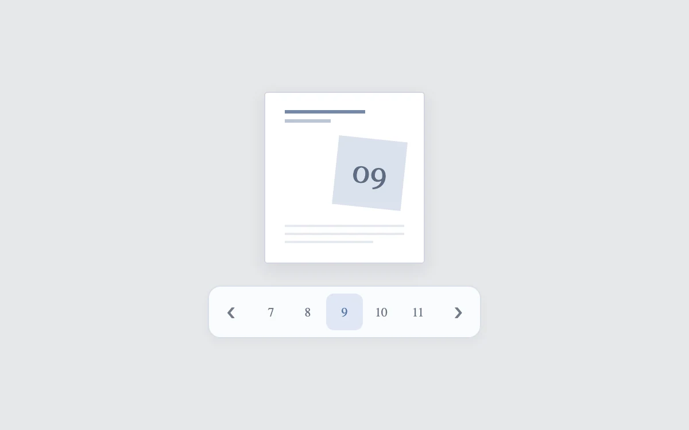

# Windowed pagination

> Keep the active page centered as a long page list advances.

- **Common name:** Sliding pagination
- **Category:** Components & interactions
- **Live demo:** https://www.subframe.com/motion/compact-pagination
- **Source:** Subframe (original, MIT)
- **Dependencies:** none

## Use case

Keep the active page centered as a long page list advances.

## Interaction

Change the page

## Look

Cool light-grey background, a white document sheet with skeleton lines and a tilted pale-blue numbered tile, above a white rounded bar of page numbers.

## Motion

Changing page slides the number strip sideways over 250 ms ease-out, keeping the current page centred until the ends; the preview tile re-tilts a few degrees in 230 ms.

## How to adapt

The strip offset is the inline `translateX` on `page-numbers`, computed from `start` (a five-slot window, 32 px per button) with a 250 ms CSS transition; `page-art` rotation is decorative. Replace the hard-coded 20-page total (also the 640 px strip width) and the `page-sheet` mock.

## Reduced motion

Live system preference disables decorative motion; all controls remain usable. Keyboard actions settle immediately.

## Limitations

Twenty local page states with a sliding visible window. No content is fetched.

## Taxonomy

- **Components:** navigation
- **Triggers:** press, state
- **Techniques:** slide, rotate
- **Feel:** subtle
- **Contexts:** app, dashboard
- **Tags:** pagination, windowing, navigation, document
- **Also known as:** animated pagination, page number carousel, paginator, pager control
- **Surface color:** `#edf0f3`

## Code

See [`component.tsx`](component.tsx).
