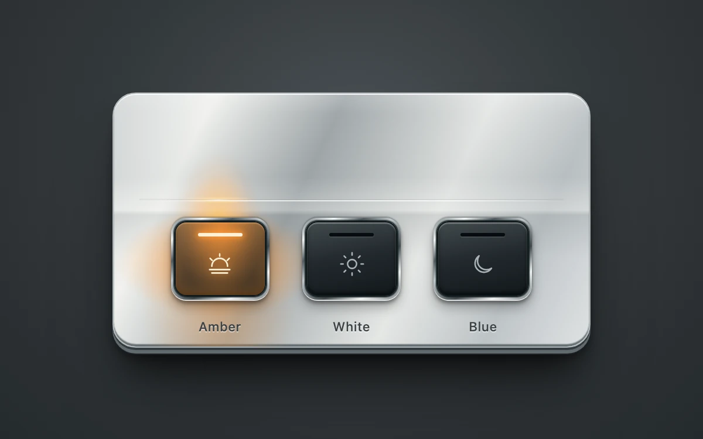

# Illuminated metal keys

> Three backlit keys cast amber, white or blue reflections across a shared metal housing.

- **Common name:** Backlit metal buttons
- **Category:** Components & interactions
- **Live demo:** https://www.subframe.com/motion/contact-metal
- **Source:** Subframe (original, MIT)
- **Dependencies:** none

## Use case

Make a selected control feel connected to its surroundings through localized reflected light.

## Interaction

Select a light color to illuminate its key and the metal above it.

## Look

Brushed-silver plate on a dark graphite backdrop with three dark glass keys in chrome bezels, line icons, labels, and amber light spilling onto the metal.

## Motion

Selecting a key fades its lens illumination and emitter glow on and crossfades a coloured reflection across the housing above it over 220 ms; pressing dips the bezel 2 px.

## How to adapt

Light is pure CSS: each `.sf-contact-metal-reflection` stacks radial gradients at `--source-x` tinted by `--light`, toggled by `data-lit` with `opacity 220ms cubic-bezier(.22,1,.36,1)`; selected keys light `.sf-contact-metal-illumination` and `.sf-contact-metal-emitter`. Edit `LIGHTS` for colours and labels.

## Reduced motion

Selection and reflected light update immediately. Keyboard selection also skips transitions.

## Limitations

Three local color presets with authored CSS reflections. No connected light hardware, arbitrary DOM reflection engine or physically based lighting simulation. No canvas or WebGL required.

## Taxonomy

- **Components:** button, toggle
- **Triggers:** state, press
- **Techniques:** glow, fade
- **Feel:** refined
- **Contexts:** app, landing
- **Tags:** css, proximity, reflection, metal, lighting, neighboring surfaces, material, selection, radio group, backlit keys
- **Also known as:** skeuomorphic radio buttons, glowing key selector, hardware control panel, illuminated mode switch
- **Surface color:** `#34393c`

## Code

See [`component.tsx`](component.tsx).
