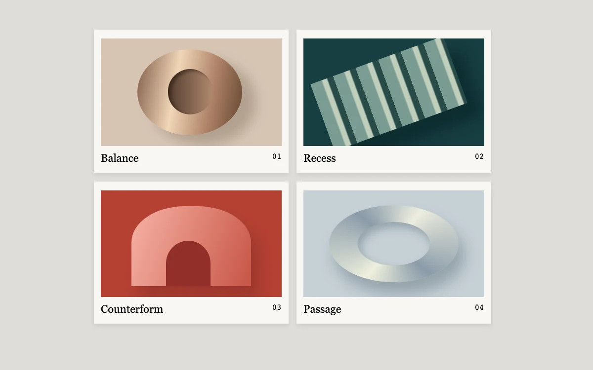

# Small editions

> An expandable collection of sculptural art prints keeps its place in a contact sheet.

- **Common name:** Expandable image grid
- **Category:** Animation & motion
- **Live demo:** https://www.subframe.com/motion/contact-sheet
- **Source:** Subframe (original, MIT)
- **Dependencies:** none

## Use case

Preview a portfolio image without losing the surrounding collection.

## Interaction

Expand a print

## Look

Warm grey page with a two-by-two grid of off-white mats framing sculptural forms on tan, teal, brick red and pale blue, with serif captions.

## Motion

Clicking a print expands it from its cell to fill the sheet over 0.5 s ease-out while the others fade to 25%. The real layout changes once; transforms animate the visual difference and inverse scaling preserves the caption's proportions.

## How to adapt

The click handler captures visible `.print` bounds before updating `selected`. `useLayoutEffect` commits the new layout and uses WAAPI transforms to animate from those bounds; caption keyframes apply inverse scale. Existing animations cancel and retarget from the visible state. `[data-muted=true]` dims siblings. Replace `names` and the CSS-drawn art with your images.

## Reduced motion

Live reduced-motion preferences remove interpolation and decorative playback. All content and native controls remain available. Keyboard changes settle immediately.

## Limitations

Original demonstration content; adapt labels and state to the host product.

## Taxonomy

- **Components:** gallery, card
- **Triggers:** press
- **Techniques:** layout, fade
- **Feel:** refined, subtle
- **Contexts:** editorial, app
- **Tags:** gallery, expand, layout, art, selection
- **Also known as:** click-to-enlarge grid, expanding portfolio card, inline lightbox, dim siblings on expand
- **Surface color:** `#deddd9`

## Code

See [`component.tsx`](component.tsx).
