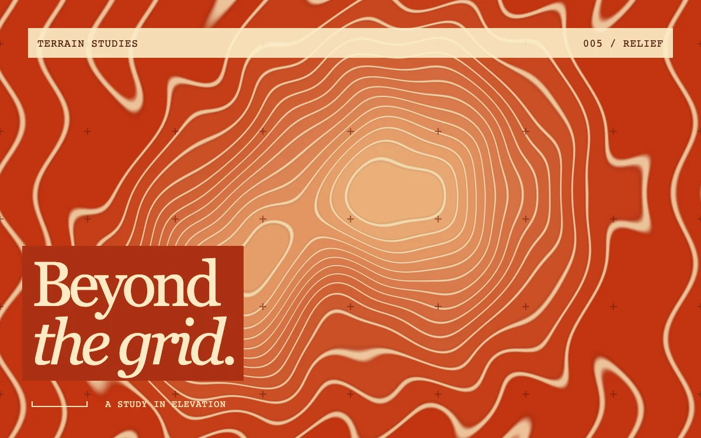

# Contour terrain

> Slowly shifting elevation bands carve warm paper into a layered topographic relief.

- **Common name:** Topographic contour shader
- **Category:** WebGL & shaders
- **Live demo:** https://www.subframe.com/motion/contour-terrain
- **Source:** Subframe (original, MIT)
- **Dependencies:** none

## Use case

Outdoor identities, geography stories, architecture portfolios, or an editorial cover with dimensional texture.

## Interaction

Play or pause the material study.

## Look

Burnt-orange field of cream contour lines ringing a pale peak, faint crosshair grid marks, a cream monospace label bar and a serif headline on rust.

## Motion

The terrain drifts on slow sine offsets (periods about 37 and 48 s), so contour bands continuously creep and reshape; a pause button stops the loop.

## How to adapt

All motion is the `terrain` function in `FRAGMENT`: tune its `u_time` multipliers for drift speed, the Gaussian hills for shape and `altitude * 15.0` for band count; `orange` and `sand` set the palette. Replace the overlay copy.

## Reduced motion

Displays one stable, representative frame. Responds immediately when the system preference changes.

## Limitations

Requires WebGL 1; a static CSS composition remains visible when WebGL is unavailable or lost. A generative relief, not geographic data. Contour edges redraw in the fragment shader.

## Taxonomy

- **Components:** background
- **Triggers:** ambient
- **Techniques:** shader, gradient
- **Feel:** calm, refined
- **Contexts:** editorial, landing
- **Tags:** contour, terrain, topographic, map, paper, relief, orange, editorial, native webgl
- **Also known as:** topographic map background, animated contour lines, topo lines hero, elevation map shader
- **Surface color:** `#c34520`

## Code

See [`component.tsx`](component.tsx).
