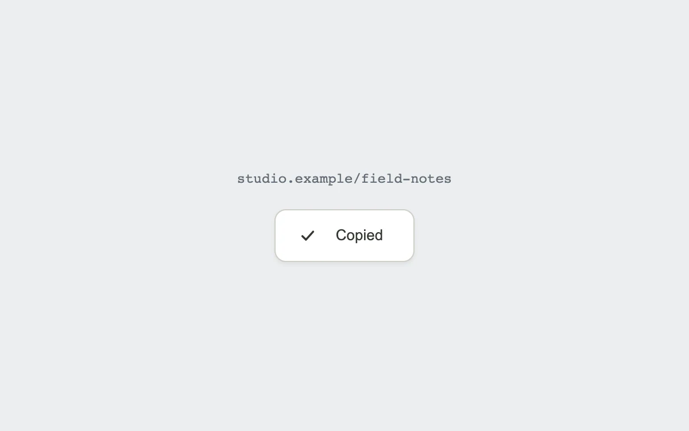

# Copy, confirmed

> A copy icon draws into a check, while its label quietly confirms the action.

- **Common name:** Copy to clipboard button
- **Category:** Components & interactions
- **Live demo:** https://www.subframe.com/motion/copy-button
- **Source:** Interior (adapted, MIT) — https://www.interior.dev/docs/copy-button · [original code](https://github.com/ddoemonn/interior/blob/314800833bf01e23e6ae74c2a17fbdaac3688c84/components/interior/copy-button.tsx)
- **Dependencies:** motion@12.0.5

## Use case

Confirm that a share link, token or command has actually reached the clipboard.

## Interaction

Copy the example link

## Look

Cool light-grey page with a grey monospace URL above a single white rounded button holding a small line icon and label.

## Motion

Clicking fades and shrinks the copy icon as a checkmark draws in 0.26 s; labels crossfade on springs with a 3 px blur and offset, reverting after 2 s.

## How to adapt

`useCopyToClipboard` (with `writeFallback`) owns status and the 2000 ms `timeout`; the checkmark animates `pathLength` with `DRAW`, icons and `labels` crossfade with `CROSSFADE`. Replace the example URL and `labels`; keep the error state and live announcement.

## Reduced motion

The checkmark and status appear immediately, with no scaling, travel or blur.

## Limitations

Clipboard permissions can be denied; the component reports failure and keeps the example link visible.

## Taxonomy

- **Components:** button
- **Triggers:** press, state
- **Techniques:** path, fade, blur, spring
- **Feel:** subtle, refined
- **Contexts:** app, landing
- **Tags:** button, clipboard, copy, click, checkmark, SVG, path drawing, confirmation
- **Also known as:** copy link button, clipboard confirmation, copied checkmark, copy code button, click to copy
- **Surface color:** `#eceef0`

## Code

See [`component.tsx`](component.tsx).
