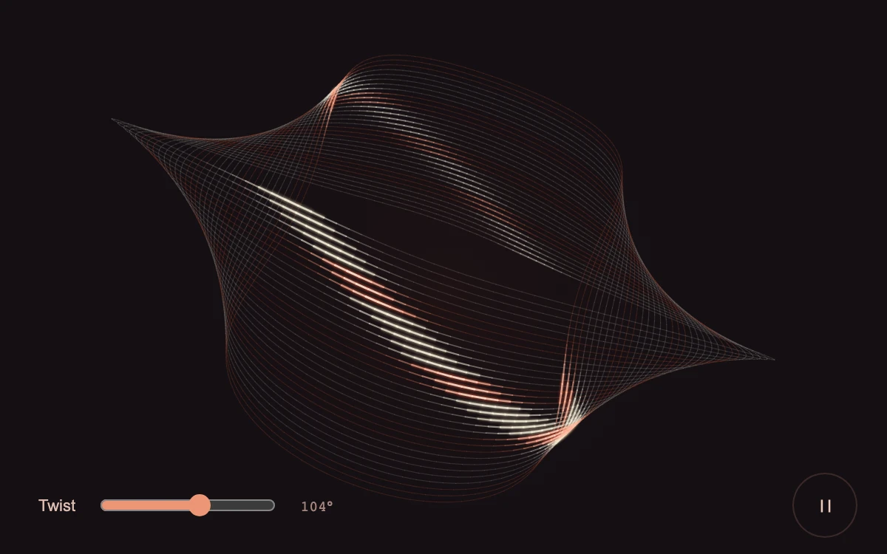

# Light weave

> Coral and white light travels through a suspended woven loop whose curvature changes under a direct drag.

- **Common name:** Draggable light ribbon
- **Category:** Animation & motion
- **Live demo:** https://www.subframe.com/motion/cove-light
- **Source:** Subframe (original, MIT)
- **Dependencies:** none

## Use case

Interactive light sculptures, expressive loading surfaces and procedural motion studies.

## Interaction

Drag the loop or adjust Twist; pause to inspect the light.

## Look

Fine cream and coral strands form a twisted, translucent wireframe loop on a near-black plum field, with a coral slider and round pause button.

## Motion

Two bright pulses continuously circle the 32-strand loop, staggered per strand with soft glow; horizontal drag, arrow keys or the slider re-bend its twist between 0 and 180°.

## How to adapt

Geometry is built in `project` and `geometry` (32 lanes × 144 segments) and lit in `paint`, where the `pulse` term sets light speed (1.1) and sharpness (exponent 18) and `hot` picks coral lanes. Drag maps to `change`; keep `cancel` and the reduced-motion branch.

## Reduced motion

Traveling light stops. Direct twist input still redraws the static geometry; host pause cancels a captured gesture and stops the clock.

## Limitations

Depth-sorted Canvas 2D strands, not a physically simulated fabric or ray-traced light source. The closed band has a bounded twist and no external assets.

## Taxonomy

- **Components:** scene, background
- **Triggers:** ambient, drag
- **Techniques:** canvas, glow, 3d, loop
- **Feel:** refined, calm
- **Contexts:** landing, editorial
- **Tags:** light, ribbon, weave, canvas, projection, pulse, twist, drag
- **Also known as:** twisted ribbon animation, glowing line loop, wireframe light sculpture, procedural ribbon hero
- **Surface color:** `#140f13`

## Code

See [`component.tsx`](component.tsx).
