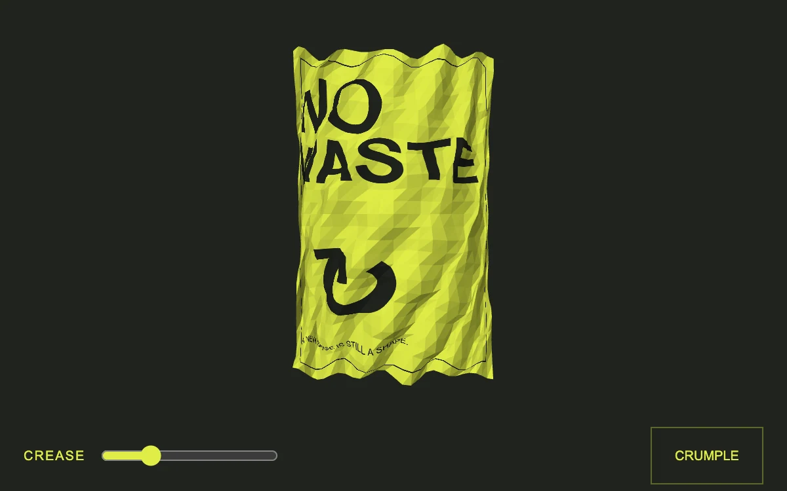

# Crease reveal

> An acid-yellow poster compresses into a faceted paper object and unfolds again.

- **Common name:** Paper fold shader
- **Category:** WebGL & shaders
- **Live demo:** https://www.subframe.com/motion/crease-reveal
- **Source:** Subframe (original, MIT)
- **Dependencies:** none

## Use case

Reveal the surface and volume of printed material through one reversible transformation.

## Interaction

Crumple the paper or adjust the crease.

## Look

A faceted acid-yellow paper poster with heavy black sans type and a large arrow glyph, slightly crumpled, on a near-black olive background with yellow controls.

## Motion

Pressing the button crumples the flat poster mesh into a faceted ball, or flattens it, easing exponentially (about 95 ms time constant); the crease slider sets the deformation directly.

## How to adapt

Deformation lives in `point`, blending the flat sheet and a noisy sphere by `amount` (`Math.pow(p, 0.78)`); `frame` eases `amount` toward `target` with a 95 ms constant. Redraw the 2D `paper` canvas with your artwork and keep `cr-fallback`.

## Reduced motion

Deliberate controls update a still mesh without interpolation.

## Limitations

Requires WebGL 1; a static poster appears if unavailable. A deterministic faceted deformation, not a physically accurate self-colliding sheet.

## Taxonomy

- **Components:** scene, image
- **Triggers:** press, drag
- **Techniques:** shader, 3d, morph
- **Feel:** bold, playful
- **Contexts:** landing, editorial
- **Tags:** native webgl, paper, mesh deformation, facets, printed material
- **Also known as:** crumpled paper effect, paper crumple animation, poster mesh deformation, low-poly paper
- **Surface color:** `#20241e`

## Code

See [`component.tsx`](component.tsx).
