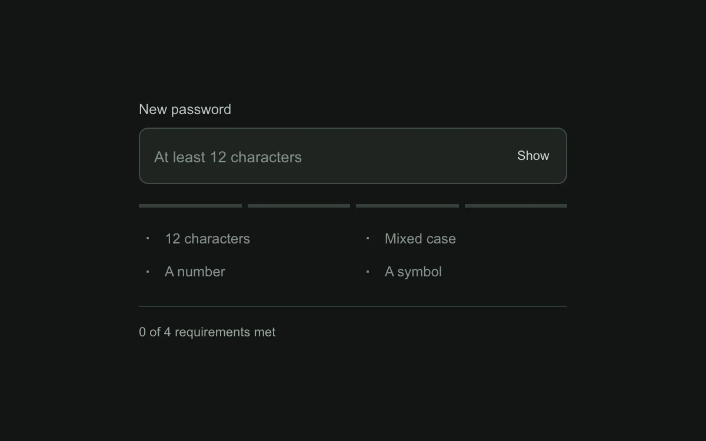

# Credential meter

> Four quiet segments track which password requirements are satisfied.

- **Common name:** Password strength meter
- **Category:** Components & interactions
- **Live demo:** https://www.subframe.com/motion/credential-meter
- **Source:** Subframe (original, MIT)
- **Dependencies:** none

## Use case

Show the remaining requirements while a user chooses a credential.

## Interaction

Type a password and toggle its visibility.

## Look

Near-black green-tinted page with a dark rounded password field, four thin grey meter segments, a two-column requirements list and a divider above status text.

## Motion

Typing fills one of four meter segments per satisfied rule, left to right, fading each to mint green over 180 ms while matching rule labels brighten and gain a check.

## How to adapt

Policy is the `rules` array (label plus `met` test) and `count` drives the `.meter i` segments via `data-met`; the only motion is a 0.18 s colour transition in CSS. Replace the rules with your policy and wire `value` to your form.

## Reduced motion

Requirement states update instantly; the meter has no animated travel.

## Limitations

A local policy checklist, not a password strength estimate or authentication system.

## Taxonomy

- **Components:** input, progress, form
- **Triggers:** keyboard, state
- **Techniques:** fade
- **Feel:** subtle
- **Contexts:** app
- **Tags:** password, rules, validation, segmented, meter, form, input
- **Also known as:** password requirements checklist, password rules indicator, segmented strength bar, password validation
- **Surface color:** `#121514`

## Code

See [`component.tsx`](component.tsx).
